# Rewipe 操作手冊

> **適用版本：Rewipe 1.8.0（2026-11-18）**
>
> **這一版的說明有什麼改變**：Rewink 新增[圖層編輯](#圖層編輯)（每個元素都能移動、縮放、旋轉、隱藏、調整順序，可以復原）、[字型](#字型)（電腦裡的字型也能用，可以搜尋）、[我的貼紙](#我的貼紙)（上傳自己的圖片）和[我的版型](#我的版型)（存起來重複用、匯出分享）；主題檔改用 `.rewipe-theme` 副檔名。完整的更新內容見 [Releases](https://github.com/LaneBlossom/rewipe/releases/tag/v1.8.0)。
>
> 下載和安裝 → 看 📥 [安裝說明](INSTALL.md)。

Rewipe 是 FF14 高難副本的**錄影＋復盤**工具：錄下遊戲畫面，再對照 ACT 或 FFLogs 的紀錄，一眼看出每次 pull 誰在哪個機制倒下、吃了什麼 debuff，點一下就跳到影片裡那一刻。其他遊戲也能錄。還有遊戲拍照框 **Rewink**：通關了，拍張紀念照。

上方的分頁：**錄影**、**復盤**、**壓縮**，框在一起的 **Overlay** 和 **主題**，以及拍照的 **Rewink**；右上角的 **☰** 是選單（金鑰、主介面外觀、說明、更新…）。下面每張圖的紅框編號，對應圖下方的說明。畫面上的「**?**」：滑鼠指過去會顯示那一項的說明。

> 截圖中的玩家名稱已換成「玩家A～H」，遊戲畫面也做了模糊處理。

**目錄**

- [快速開始](#快速開始)
- [功能導覽](#功能導覽)
- [錄影](#錄影)
  - [開始錄影、存檔位置、選要錄什麼](#開始錄影存檔位置選要錄什麼)
  - [畫質與聲音](#畫質與聲音)
  - [跟 ACT 同步錄影](#跟-act-同步錄影)
  - [效能監控與效能測試](#效能監控與效能測試)
- [Overlay](#overlay)
- [主題](#主題)
  - [Overlay 主題](#overlay-主題)
  - [主題編輯器](#主題編輯器)
  - [分享主題](#分享主題)
  - [主介面外觀](#主介面外觀)
- [復盤](#復盤)
  - [畫面總覽](#畫面總覽)
  - [播放清單：一次看很多個影片](#播放清單一次看很多個影片)
  - [死因與 debuff](#死因與-debuff)
  - [統計](#統計)
  - [用 FFLogs 復盤](#用-fflogs-復盤)
- [剪輯：片段、GIF、截圖、分段](#剪輯片段gif截圖分段)
- [壓縮](#壓縮)
- [Rewink 拍照框](#rewink-拍照框)
  - [Rewink 分頁](#rewink-分頁)
  - [拍照框](#拍照框)
  - [拍完編輯](#拍完編輯)
  - [圖層編輯](#圖層編輯)
  - [字型](#字型)
  - [我的貼紙](#我的貼紙)
  - [我的版型](#我的版型)
  - [版權標示和其他設定](#版權標示和其他設定)
  - [相簿、拼貼和通關提示](#相簿拼貼和通關提示)
- [☰ 選單](#-選單)
- [常用快捷鍵](#常用快捷鍵)

---

## 快速開始

**1. 先錄一段看看**

第一次打開 Rewipe 會有一段**功能導覽**，在畫面上一步一步介紹，點對話框就到下一步（見[功能導覽](#功能導覽)）。

在「**錄影**」頁按「**● 開始錄影**」，或在遊戲裡按 `Ctrl+Alt+F9`。再按一次就停止。預設只錄 FF14 的視窗，存在「影片」資料夾的 `Rewipe\FF14` 裡。

**2. 搭配 ACT 自動錄（推薦）**

1. 先開 **ACT**（要有 FFXIV 解析外掛，建議也裝 **OverlayPlugin**，才看得到倒數和戰鬥狀態）和 **FF14**，進到遊戲裡。
2. 錄影頁的「**FF14 附加功能（ACT 連線）**」顯示「**● 已連線**」。沒連上的話，見[跟 ACT 同步錄影](#跟-act-同步錄影)。
3. 勾「**自動錄影**」。之後每次倒數開打就自動開錄，滅團或通關自動停止。可以選每場存一個檔，或離開副本後把這次打的每一場串成一個長檔。

**3. 打開復盤**

錄完後按「**在復盤中開啟**」（或到「復盤」頁開啟錄影檔，每場一個檔的話可以一次全選，或直接開整個資料夾），再載入 ACT log 或貼上 FFLogs 網址，影片和戰鬥紀錄就會自動對齊。見[復盤](#復盤)。

**4. 第一次使用建議也做**

- 「錄影」頁最下面按「**⚡ 跑效能測試**」，讓它建議適合這台電腦的畫質。
- 要用 FFLogs 復盤的話，到右上角 **☰ →「FFLogs API 金鑰」**填好。

---

## 功能導覽

第一次打開 Rewipe 時會自動出現，之後可以在右上角「**☰ → 🧭 功能導覽**」重看。

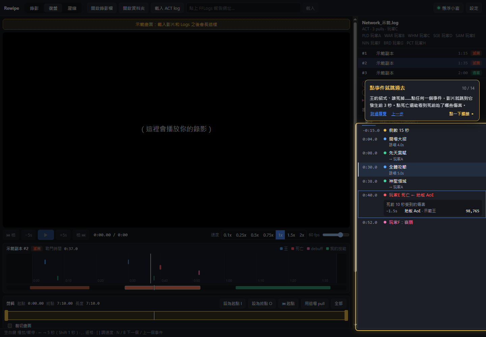

- 每一步會框出畫面上的一個地方，旁邊用一兩句話說明。**點說明框**就到下一步，也可以按「上一步」或「跳過導覽」（鍵盤：Enter / → 下一步，Esc 結束）。
- 依序介紹：三大功能 → 存檔位置 → 錄什麼 → 畫質 → 開始錄影 → 跟 ACT 自動錄 → Overlay → 復盤 → 剪輯 → 壓縮。
- 還沒載入影片和 Logs 的話，復盤的部分會先放入**示範資料**，示範點一場 pull、點一個死亡事件之後影片會跳到哪裡。導覽結束後示範資料會清掉。

**Overlay 導覽**：從 1.3.1 以前的版本更新上來時，看完「更新內容」後會自動出現一次，一步一步介紹 [Overlay](#overlay) 分頁：外觀、最上面那一列和極簡模式、電腦效能（Ping、遊戲 FPS）、FF14 的死因、DPS 和團減。之後可以在右上角「**☰ → 🧭 Overlay 導覽**」重看。

---

## 錄影

### 開始錄影、存檔位置、選要錄什麼

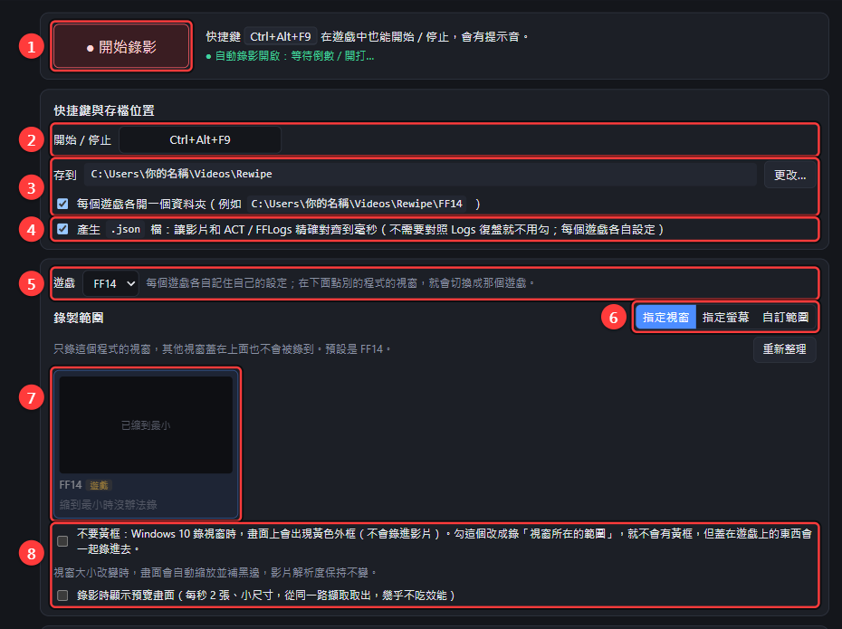

1. **開始錄影**：按按鈕，或在遊戲中按快捷鍵（預設 `Ctrl+Alt+F9`），開始和停止都會有提示音。
   - 按下去會先顯示「**準備中…**」（找遊戲視窗、Discord，大約 1 秒），這時再按一下就是取消。
   - 有開「自動錄影」的話，旁邊會顯示「自動錄影開啟：等待倒數 / 開打」。
2. **開始 / 停止快捷鍵**：點一下再按想要的組合鍵。在遊戲中也能使用。
3. **存檔位置**：錄好的影片存在哪裡，預設是「影片」資料夾裡的 `Rewipe`。
   - **每個遊戲各開一個資料夾**（預設開啟）：FF14 的錄影會存在 `Rewipe\FF14\`，其他遊戲用它自己的名稱，不會混在一起。
   - **再依照日期各開一個資料夾**（預設關閉）：再分成 `Rewipe\FF14\2026-11-17\` 這樣一天一個資料夾，用開始錄影那天的日期（跨過半夜的那一場放在開始那天）。之前錄的影片不會搬動。
4. **產生 .json 檔**：每段影片旁邊多一個很小的 `影片名.mp4.ffreview.json`，記錄影片精確到毫秒的開始時間，復盤時就能和 ACT / FFLogs 自動精確對齊。
   - 每個遊戲各自設定：**FF14 預設勾，其他遊戲預設不勾**。不需要對照 Logs 復盤就不用勾。
   - 搬移或改名影片時，`.json` 要跟著一起，不然打開時要重新對齊。
5. **遊戲**：每個遊戲各自記住自己的設定。預設是 FF14；在下面點別的程式的視窗，就會切換成那個遊戲。
6. **錄製範圍**：
   - **指定視窗**（推薦）：只錄遊戲視窗，Discord 或其他視窗蓋在上面也不會被錄進去。
   - **指定螢幕**：錄整個螢幕。
   - **自訂範圍**：用滑鼠框出要錄的區域。
7. **視窗清單**：點一下就選定要錄的視窗。遊戲縮到最小時沒辦法錄，請先把它叫出來。
   - 遊戲會排在前面並標「**遊戲**」：FF14、Windows 認得的遊戲（Xbox Game Bar 的遊戲清單），以及裝在 Steam、Epic、Riot、HoYoPlay、Battle.net 等平台的遊戲。
   - 雷電、BlueStacks、MuMu、夜神、Google Play 遊戲等**模擬器**標「**模擬器**」。
8. **其他選項**：
   - **不要黃框**：Windows 10 錄視窗時，遊戲周圍會出現黃色外框（不會錄進影片）。勾這個就不會有黃框，但蓋在遊戲上的東西會一起錄進去。
   - **錄影時顯示預覽畫面**：確認有沒有錄到正確的畫面，幾乎不吃效能。

### 畫質與聲音

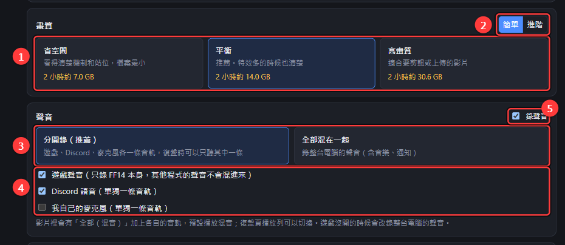

1. **畫質**：
   - **省空間**：看得清楚機制和站位，2 小時約 7 GB。
   - **平衡**（推薦）：特效多的時候也清楚，2 小時約 14 GB。
   - **高畫質**：適合要剪輯或上傳的影片。

   會自動用顯卡的硬體編碼（NVIDIA / AMD / Intel），幾乎不影響遊戲效能。
2. **簡單 / 進階**：切到「進階」可以自己調解析度、FPS、編碼器和畫質。
3. **聲音模式**：
   - **分開錄**（推薦）：遊戲、Discord、麥克風各錄成一條音軌，復盤時可以只聽其中一條，例如只聽 Discord 的指揮。
   - **全部混在一起**：錄整台電腦的聲音，包含音樂和通知。
4. **要錄哪些聲音**：遊戲聲音（只錄遊戲本身）、Discord 語音、自己的麥克風，可以分別勾選。
5. **錄聲音**：總開關，取消勾選就只錄畫面。

錄好的影片是一般的 MP4（聲音是 AAC），Windows 內建的「媒體播放器」也能直接播。影片裡會附一張封面圖，所以在檔案總管裡有預覽圖（就算電腦沒裝 HEVC 擴充套件也看得到）。分開錄的音軌在 VLC、PotPlayer 或 Rewipe 的復盤頁可以切換。

### 跟 ACT 同步錄影

開著 ACT 的話，Rewipe 會讀取 ACT 正在寫的 log，知道現在在哪個副本、第幾場、開打了沒有、是滅團還是通關。

1. **與 ACT 連線**：FF14 附加功能的總開關（跟 Overlay 分頁的同一個開關）。關掉的話就不讀 ACT，只當作一般錄影軟體使用，Overlay 上也不會有 FF14 的欄位。錄其他遊戲時會自動關閉。這只影響錄影和 Overlay；復盤頁不管這裡有沒有開，都可以載入 ACT log 和 FFLogs。
2. **ACT 連線狀態**：ACT 開著、進遊戲後 ACT 開始寫 log，這裡就會變成「● 已連線：副本名稱 · 下一場 #N」。
   - 下面一行是 ACT 的 **FFXIV 解析外掛版本**，以及有沒有 **OverlayPlugin**（從 ACT 正在寫的 log 開頭讀出來的）。
   - 「進入 / 離開戰鬥」和「倒數」的紀錄是 **OverlayPlugin** 寫的，自動錄影靠它判斷開打。顯示「OverlayPlugin 沒有」或「版本太舊」時，請在 ACT 的 **Plugins → Get Plugins…** 安裝或更新 OverlayPlugin。
   - 沒有 OverlayPlugin 時，Rewipe 會改用「有人開始打怪」判斷開打、15 秒沒人在打（或滅團 / 通關）就算打完，自動錄影照樣能用；但看不到倒數，「倒數開始時」不會觸發，請改成「進入戰鬥時」。
3. **ACT log 資料夾**：
   - 預設是 `%APPDATA%\Advanced Combat Tracker\FFXIVLogs`，下面會顯示找到的最新 log。
   - 顯示「找不到這個資料夾」的話，到 ACT 的 **Plugins → FFXIV Settings** 看 log 存在哪裡，再按「**更改…**」選那個資料夾。
4. **自動錄影**：開打時自動開始錄，滅團或通關後自動停止，沒在打的時間不錄，最省硬碟。「從什麼時候開始錄」有兩個選擇：
   - **倒數開始時**（高難本推薦）：含倒數；倒數取消或沒開打，檔案會自動刪掉。
   - **進入戰鬥時**：沒有倒數也會錄，但打野外的怪也會觸發。
5. **存成**：
   - **每場一個檔**：每次 pull 一個檔案。復盤時可以一次開很多個（見[播放清單](#播放清單一次看很多個影片)）。
   - **串成一個長檔**：每場還是照常錄，**離開副本**（或休息超過 20 分鐘）後，把這次打的每一場接成一個檔案，例如 `FF14_…_絕伊甸_共12場.mp4`，每場的小檔會刪掉。不會重新編碼，很快。中途關掉 Rewipe 也沒關係，下次開啟時會接著合併（改回「每場一個檔」的話就不合併，小檔原封不動）。不小心串成長檔，也可以在復盤頁的剪輯區切回每場一個檔。
**手動錄的長影片**：以前的「自動分段」移到復盤頁的剪輯區了。載入影片和 Logs 後，可以每場切成一個檔案，或只留戰鬥的部分（見[剪輯](#剪輯片段gif截圖分段)）。

自動錄的檔案，檔名會帶副本名稱、第幾場、通關或滅團。之後在復盤頁打開時，會自動對齊 ACT 的紀錄；串成長檔的影片，時間軸上會標出每一場接起來的地方。

**開打了卻沒有自動錄影？** Rewipe 會跳出 Windows 通知（遊戲裡也看得到）並在錄影頁說明原因：

- 「自動錄影」沒有勾。
- 設定是「倒數開始時」，但這場開打前沒有倒數（例如副本小怪、野外）。
- ACT 沒有 OverlayPlugin，log 裡沒有戰鬥、倒數紀錄（見上面第 2 點）。

**怎麼算「一場」**（自動錄影、場次編號、即時 DPS、復盤、長影片分段都用同一套）：

- **在副本裡**（四人本、討伐、團本、高難本）：只有**滅團、通關、有人按新的倒數、離開副本**才算一場結束。王轉場、過場動畫時遊戲有時會暫時變成「非戰鬥中」，這不算結束，再久都是同一場、同一個檔案；四人本小怪一路打到王、中間沒滅團，就是一整個檔。滅團 / 通關的紀錄是 ACT 本身寫的，有沒有 OverlayPlugin 都準。
  - 保險：脫離戰鬥超過 **5 分鐘**還沒任何結束訊號（例如 ACT 中途重開漏了紀錄），會當成結束，存檔時把多等的那段剪掉。
- **野外、打木樁**：不會有滅團 / 通關 / 離開副本的訊號，所以**脫戰 60 秒**就算結束，存檔時自動把多等的那段剪掉，影片停在打完後 6 秒。60 秒內再開打還是同一場。
- 怎麼知道在副本裡：副本會在 ACT 的 log 寫副本事件的紀錄，野外不會；名稱是高難本的也直接算副本。
- **開打前**：有倒數就從倒數開始都算這一場（倒數時唱的起手、開怪前的增益都看得到）；沒有倒數只算開打前 5 秒。高難本（名稱開頭是「絕」「極」「滅」，或有「零式」）如果 log 裡沒有倒數紀錄，會當作有 16 秒倒數。

### 效能監控與效能測試

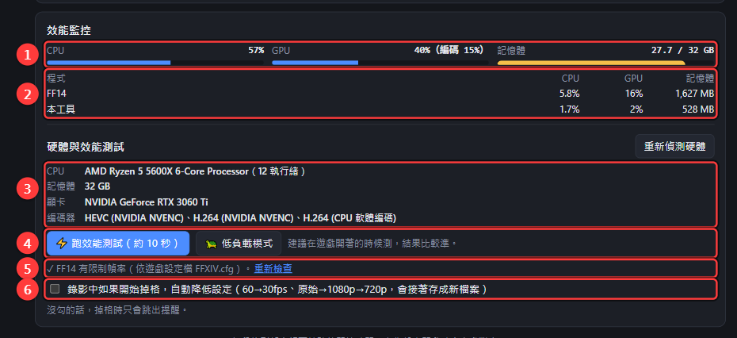

1. **效能監控**：即時顯示 CPU、GPU（含編碼用量）、記憶體，錄影時可以確認有沒有拖慢遊戲。
   - NVIDIA 顯卡用驅動附的工具讀取顯卡用量，幾乎不吃效能。
   - 其他顯卡讀取 Windows 的顯卡計數器；這台電腦讀得太慢時會自動放慢，太慢就停用並顯示「–（這台電腦讀取顯卡用量太慢，已停用）」，CPU 和記憶體照常顯示。
2. **各程式用量**：FF14、ACT、錄影編碼（ffmpeg）和 Rewipe 自己各吃了多少。
3. **硬體資訊**：自動偵測 CPU、記憶體、顯卡，以及可以用的硬體編碼器。
4. **效能測試 / 低負載模式**：
   - **跑效能測試**：花大約 10 秒試錄幾種設定，測完會建議最適合這台電腦的設定。建議在遊戲開著的時候測。測試時如果顯卡被遊戲吃滿，會直接說明原因和解法。
   - **低負載模式**：給比較舊的電腦，一鍵切到 720p / 30fps / 省空間。
5. **FF14 幀率檢查**：Rewipe 會讀 FF14 自己的設定檔，檢查有沒有限制幀率。
   - 沒有限制的話會顯示黃色提醒：遊戲會把顯卡吃到 99～100%，錄影搶不到顯卡就會掉格，介面也可能卡住。
   - 解法：在遊戲的「**系統設定 → 顯示設定**」把**幀率上限**改成螢幕更新率或 60fps，改完按「重新檢查」。
6. **自動降低設定**：勾起來的話，錄影中開始掉格，就會自動降低設定（60→30fps、原始→1080p→720p），接著存成新檔案。沒勾的話只會跳出提醒。

---

## Overlay

一個浮在遊戲上面的小視窗，**任何遊戲都能用**，**不會被錄進影片**。可以直接按錄影 / 停止，也可以**不錄影、單純當效能或 FF14 log 的監控儀表板**。

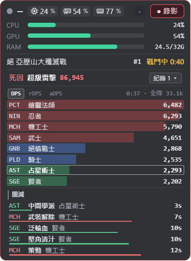

由上到下（每一項都能單獨開關、調整順序，見下面的設定）：

- **最上面那一列**：錄影狀態和計時、旁邊的小數值（Ping、遊戲 FPS、CPU…，顏色會依狀況變綠 / 黃 / 紅）、📌（釘選位置：點了之後 Overlay 固定在原地，不能拖動，再點一下解除）、`▴` / `▾`（切換極簡模式）、「● 錄影」或「■ 停止」。
- **電腦效能**：
  - **Ping**：到遊戲伺服器的延遲（純數字，或加上一分鐘的波形圖）。量的是**現在在最前面的遊戲**，切到瀏覽器、Discord 時繼續量上一個遊戲；任何用 TCP 連線的遊戲都能量，用 UDP 的遊戲（多數射擊、MOBA）量不到。每 2 秒一個很小的連線，幾乎不佔網路和效能。
  - **遊戲 FPS**：遊戲畫面本身的幀數，需要 RTSS（見下面[遊戲 FPS 怎麼設定](#遊戲-fps-怎麼設定)）。跟「錄影 fps」不同。
  - **CPU / GPU / 記憶體**長條圖：超過 80% 變黃色，超過 92% 變紅色。
  - **錄影 fps、掉格數**：只在錄影時出現，跟不上時變紅色。
- **FF14**（ACT 連線時才會出現；錄其他遊戲時不會出現）：
  - **副本狀態列**：副本名稱、第幾場、倒數 / 戰鬥中和計時 / 滅團 / 通關，三項可以分開勾選。
  - **死因**：自己倒下後大約 1 秒，用**一行**顯示打死你的招式和傷害，被復活後消失。
  - **DPS / HPS**：這一場每個人的數字和全隊總和，坦克藍色、補師綠色、DPS 紅色，你自己那一行有外框。標題列可以直接切換 **DPS / rDPS / aDPS / HPS / rHPS**（出現哪幾個在 Overlay 分頁勾選）：
    - **DPS**：自己打出的傷害（包含隊友團輔加成的部分）。
    - **rDPS**：扣掉隊友團輔帶來的傷害，再加上自己的團輔幫隊友多打的傷害。
    - **aDPS**：扣掉隊友團輔帶來的傷害，只看自己的實力。
    - **HPS**：有效治療量，不算溢補（補到滿血以外的部分）。**rHPS**：原始治療量，溢補也算進去。溢補用補血那一刻目標的血量估算；盾不算治療。
    - 跟 FFLogs 同概念；爆擊、直擊類團輔是估計值，數字會跟 FFLogs 略有差距。召喚獸的傷害算給主人。戰鬥結束後保留上一場的數字，下一場開打時重新計算。
  - **團減**：隊伍現在生效的團減和團盾：誰放的、什麼技能、還剩幾秒，底下的細線是剩下的時間。快結束的排上面。技能名稱直接用遊戲裡的名稱。騎士的武裝戍衛只算實際生效的時間（騎士停止後再 5 秒）。

**死亡紀錄**：死因那一行右邊的「**紀錄**」按鈕（沒在顯示死因時，副本狀態列上的「**死亡 N**」）會打開死亡紀錄：這次開 Rewipe 以來每次死亡的時間和死因。點其中一筆看詳細：

- 來自哪個敵人、被打之前**剩多少 HP**、**溢出**多少（被一下打死還是被補不起來）。
- 當時有哪些**團減**（沒有的話顯示紅色「沒有」），身上有什麼 **debuff**（例如易傷）。
- **死前幾下**的傷害和時間，打死你的那一下標紅。看得出是被連段打死、DoT 死，還是一下秒殺。
- 只看得到隊伍的團減，看不到個人減傷（例如鐵壁）。log 裡找不到確定打死你的那一下時，只顯示最後一下，不顯示 HP 和溢出。

**移動 Overlay**：按住空白處（不是按鈕的地方）拖到想要的位置，下次開啟會記住。

### Overlay 分頁：外觀和最上面那一列

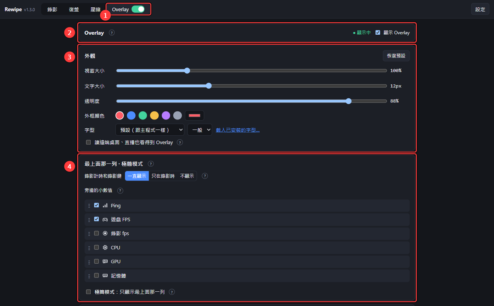

1. **分頁標籤**：上面的開關直接開 / 關 Overlay（綠色 = 開著），點文字進到這個分頁。關著的時候也可以先調好，改了馬上生效。旁邊框在一起的「**主題**」是 Overlay 的外觀主題，見[主題](#主題)。
2. **顯示 Overlay**：同一個開關。
3. **外觀**：視窗大小、文字大小、透明度。「恢復預設」一鍵改回來。外框顏色、字型和小裝飾在「[主題](#主題)」分頁。
   - **讓遠端桌面、直播也看得到 Overlay**：平常 Overlay 對所有擷取畫面的程式隱藏，才不會被錄進影片。打開後 Chrome 遠端桌面、Discord 直播看得到；錄「整個螢幕」或「框選範圍」也會錄到，錄「遊戲視窗」不會。
4. **最上面那一列 · 極簡模式**：
   - **錄影計時和錄影鍵**：一直顯示 / 只在錄影時 / 不顯示。只想監控的話選「不顯示」，快捷鍵照樣能錄影。
   - **旁邊的小數值**：勾選要顯示的（Ping、遊戲 FPS、錄影 fps、CPU、GPU、記憶體），按住 `⋮⋮` 拖動調整順序。
   - **極簡模式**：Overlay 只剩這一列，最不擋畫面，可以當成很小的錄影鍵、Ping 或效能監控。開著時電腦效能、FF14 那兩塊上面會有黃色提示和「關閉極簡模式」按鈕，下面的選項照樣可以先設定。
   - **釘選位置**：Overlay 固定在目前的位置，按住拖動也不會移動（按鈕照常能按），跟 Overlay 上的 📌 是同一個開關。

### Overlay 分頁：電腦效能和 FF14

1. **電腦效能**：每一項可以單獨勾選。Ping 和遊戲 FPS 可以選「數字」或「數字 + 波形圖」。
2. **`⋮⋮`**：按住拖動，調整在 Overlay 上的順序（FF14 的項目也一樣）。
3. **FF14 log（ACT 連線）**：跟錄影頁的「FF14 附加功能」是同一組設定：與 ACT 連線的開關、連線狀態、ACT log 資料夾（見[跟 ACT 同步錄影](#跟-act-同步錄影)）。
4. **在 Overlay 上顯示**：
   - **副本狀態列**：副本名稱、第幾場、戰鬥狀態可以分開勾選。
   - **死因**：「死掉時才出現」或「固定顯示上一次」（一直留著這個副本上一次的死因，復活後變淡）；「詳細裡列出死前幾下」0～5 下。
   - **DPS / HPS**：可以切換的數字（DPS、rDPS、aDPS、HPS、rHPS 勾選要哪幾種，只勾一個就固定顯示那一個）、自己固定在第一列、放大自己那一列、只顯示自己。
   - **團減**：最多顯示幾個（1～10）、要看哪些職業放的（例如只看坦克和補師）。
   - **什麼時候出現**：DPS、團減都可以選「有才出現」或「**固定顯示**」。固定顯示會一直空出固定的位置（DPS 是隊伍人數那麼多列：8 人副本 8 列、4 人副本 4 列、單人 1 列；團減是「最多顯示」那麼多列），欄位不會上下伸縮，眼睛每次看同一個地方就找得到。

### 遊戲 FPS 怎麼設定

遊戲 FPS 讀的是 **RivaTuner Statistics Server（RTSS）** 的數字，Rewipe 自己不注入遊戲。

1. **安裝**：RTSS 會跟 **MSI Afterburner** 一起安裝，也可以單獨安裝。
2. **開啟 RTSS**：開始功能表搜尋「RivaTuner Statistics Server」，它會縮到工作列右下角（螢幕圖示）。**只開 MSI Afterburner 不一定會帶起 RTSS。** 偵測到有裝但沒開時，Overlay 分頁會有「**幫我開啟 RTSS**」按鈕。
3. **RTSS 設定**：Application detection level 選 **Low** 以上。不想在遊戲裡看到 RTSS 自己的數字，可以關掉 Show On-Screen Display，不影響 Rewipe。想每次開機自動開，勾 Start with Windows。
4. 回到遊戲畫面，Overlay 分頁「遊戲 FPS」下面出現「● 讀得到：遊戲名稱 xx fps」就成功了。

量的是**最前面的遊戲**（跟 Ping 一樣）；遊戲縮到最小或在背景時，沒有數字或數字很低是正常的。

---

## 主題

主題只改**外觀**：底色、外框、文字顏色、字體和小裝飾。Overlay 的內容、版面和數字都不變。

### Overlay 主題

上方框在一起的「Overlay｜**主題**」，點「主題」進到這個分頁。

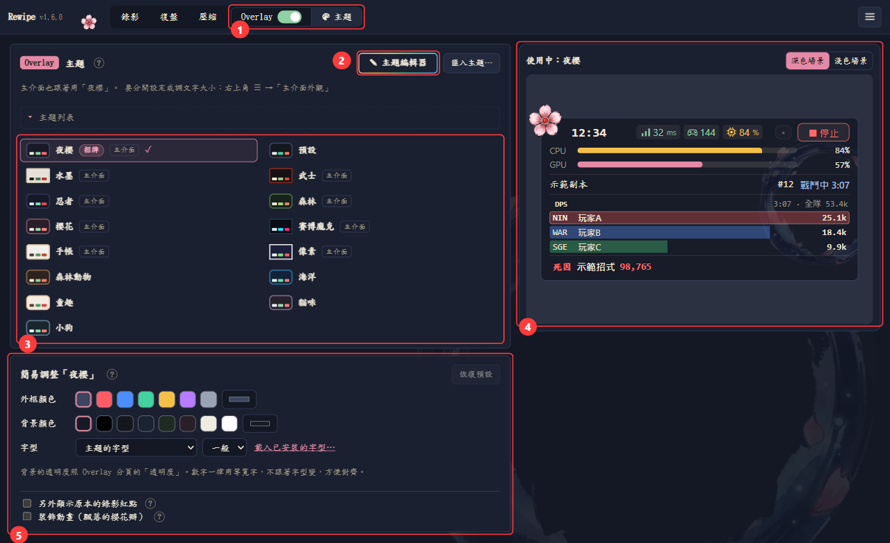

1. **主題分頁**：跟 Overlay 分頁放在同一組，這裡的主題只套用在 Overlay。
2. **主題編輯器**：以目前的主題為底，做一個自己的主題（內建主題會先複製一份），見[主題編輯器](#主題編輯器)。旁邊的「**匯入主題…**」可以裝別人分享的主題，見[分享主題](#分享主題)。
3. **主題列表**：點一下就套用，Overlay 馬上換。滑鼠移到主題上，右邊會先預覽。
   - 15 個內建主題，第一個是招牌主題「**夜櫻**」。標著「主介面」的主題，連 Rewipe 的主視窗也會一起換樣子（見[主介面外觀](#主介面外觀)）。
   - 自己做的、別人分享的主題列在「**我的主題**」。
4. **預覽**：用示範資料預覽目前（或滑鼠指著）的主題。右上可以切換深色 / 淺色場景，看看在亮的遊戲畫面上清不清楚。
5. **簡易調整**：只改目前這個主題的外框顏色、背景顏色、字型和粗細，每個主題各自記得。「**恢復預設**」改回主題原本的樣子。
   - 背景跟文字顏色太接近時會出現提醒，可以勾「**改成高對比文字**」。
   - 「**夜櫻**」在這裡還有兩個選項：
     - **另外顯示原本的錄影紅點**：夜櫻用左上角櫻花的花心當錄影燈（紅 = 錄影中、灰 = 沒在錄、橘 = 掉格）。
     - **裝飾動畫**：櫻花瓣在文字後面慢慢飄。戰鬥中會自動暫停；開「低負載模式」或錄影掉格時會自動停止。

> 改到看不清楚的話，在 Overlay 上按右鍵 →「**恢復預設主題**」就能救回來。

### 主題編輯器

按「**主題編輯器**」後，上面的主題列表會自動收起來（點那一行可以再展開），下面換成編輯器。改了會馬上存檔，右邊的預覽和 Overlay 也會馬上換。

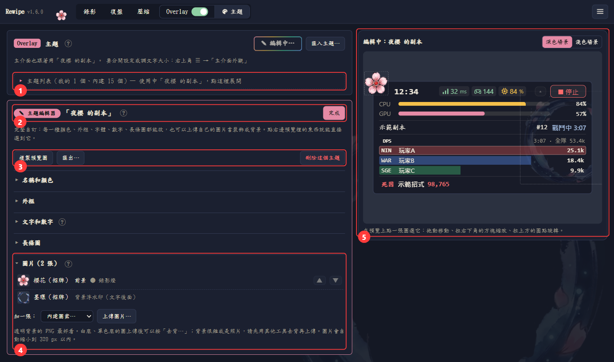

1. **主題列表（收起來）**：顯示目前用的是哪個主題，點一下展開。
2. **編輯器標題**：「完成」離開編輯器，回到簡易調整。
3. **複製預覽圖**（直接貼到 Discord）、**匯出…**（存成主題檔分享給朋友）、**刪除這個主題**。
4. **各區設定**，點標題展開：
   - **名稱和顏色**：主題名稱、作者，每一種顏色（底色、外框、文字、強調色、正常 / 注意 / 警告、長條圖…）、底色不透明度、是不是淺色底。
   - **外框**：粗細、圓角、虛線、切角。
   - **文字和數字**：標題和內文的字體，數字的字體和大小（數字一律等寬，才會對齊）。
   - **長條圖**：細線、分格、像素方塊等樣式。
   - **圖片**：可以放**內建圖案**，也可以**上傳自己的圖片**。圖片分「前景」（蓋在文字上）和「背景」（在文字後面），清單裡可以調整上下順序。白底、單色底的圖上傳後按「**去背…**」就能去掉背景；背景很雜的圖或照片，請先用其他工具去背再上傳。
5. **預覽**：直接**點預覽裡的圖片**就能選到它，拖動移動、拉右下角的方塊縮放、拉上方的圓點旋轉。

### 分享主題

- **分享出去**：在主題編輯器按「**匯出…**」，存成一個 `.rewipe-theme` 主題檔（裡面附一張預覽圖；1.8.0 以前匯出的 `.rewipe-theme.json` 也能匯入），傳給朋友就好。只想給大家看長什麼樣子的話，按「**複製預覽圖**」直接貼到 Discord。
- **裝別人的主題**：把主題檔**拖進 Rewipe 視窗**，或在主題分頁按「**匯入主題…**」。會先顯示預覽，確認後才安裝，裝好會出現在「我的主題」。
- 主題檔只有顏色、字體和圖片，不會包含程式，也不會改到你的其他設定。

### 主介面外觀

Rewipe 主視窗（錄影、復盤、壓縮這些頁面）的樣子。在右上角 **☰ →「🎨 主介面外觀…」**。

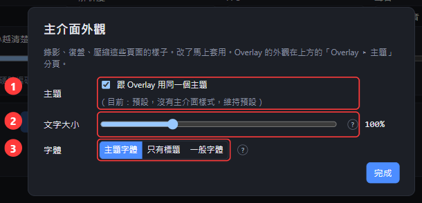

1. **主題**：勾「**跟 Overlay 用同一個主題**」，主介面就跟著 Overlay 的主題換（只有標著「主介面」的主題才有主介面的樣式，其他主題主介面維持預設）。不勾的話可以另外選一個。
2. **文字大小**：80–150%，整個視窗（字和按鈕）一起放大縮小，版面不會亂。預設主題也能用。
3. **字體**：楷書、點陣字、手寫字小的時候比較難讀，可以選：
   - **主題字體**：全部用主題的字體。
   - **只有標題**：只有 Rewipe 標題和卡片標題用主題的字體。
   - **一般字體**：完全不換字體，只換顏色和背景。

主介面套用「夜櫻」的樣子，背景有淡淡的浮水印：

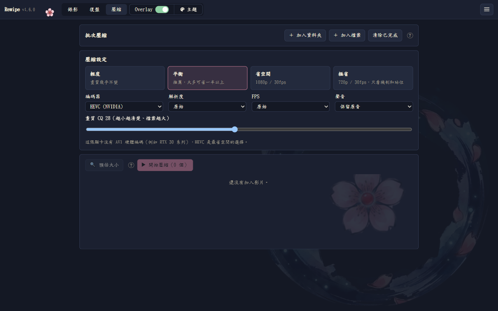

---

## 復盤

### 畫面總覽

在復盤頁打開錄影檔，再載入 ACT log 或 FFLogs 報告，影片和戰鬥紀錄就會自動對齊。

1. **載入**：
   - **開啟錄影檔**：選要看的影片，可以一次選很多個。也可以直接把影片（一個或很多個）拖進視窗。
   - **開啟資料夾**：資料夾裡的影片全部放進播放清單。
   - **載入 ACT log**：選 ACT 的 `Network_xxxxx.log`。也可以直接拖進來。
   - **FFLogs 網址**：貼上 FFLogs 報告網址後按「載入」，需要先到右上角 ☰ →「FFLogs API 金鑰」填好。
   - 右邊整欄的左邊界可以**左右拖動**調整寬度，pull 清單下面的線可以**上下拖動**調整高度，點兩下恢復預設。
   - 不管錄影頁現在設定成錄哪個遊戲、有沒有開 FF14 附加功能，復盤頁都可以載入 ACT log 和 FFLogs。
2. **影片播放器**：逐格、±5 秒、0.1x～2x 慢動作，看清楚每一個機制。
3. **這場 pull 的時間軸**：上排是王的技能和詠唱，下面依序是死亡、debuff、我的技能。點時間軸任何位置就跳到那個時間；滑鼠指到事件點會顯示它的時間和名稱。**滑鼠滾輪**可以放大縮小（以滑鼠位置為中心），放大後按住拖曳或 `Shift` + 滾輪左右移動，右上角「還原」回到整場。下方長條是整支影片，標出每場 pull 在影片裡的位置（串成長檔的影片，虛線是接起來的地方）。
4. **剪輯**：一直展開在這裡，見[剪輯](#剪輯片段gif截圖分段)。
5. **時間對齊**：平常收起來，標題列會顯示影片從幾點開始。黃字「估計的」表示是從檔名或檔案時間推算的，事件對不上時點一下展開調整。
   - Rewipe 錄的影片會精確對齊，不用動。
   - 如果差了一點：在右邊點一個明顯的事件（例如某人死亡），用逐格找到畫面上它真正發生的那一格，再按藍色按鈕，就會對準。
   - 也可以用 ±1 秒 / ±0.1 秒微調。
6. **分頁**：一次開了很多個影片時，這裡有「**Logs 場次**」和「**影片清單**」兩個分頁，見[播放清單](#播放清單一次看很多個影片)。只開一個影片時不會出現。
7. **pull 清單**：這份 log 裡的每一場，包含副本、第幾場、打了多久、通關或滅團。最上面是檔名、錄製者和 pull 數；隊員名單平常收起來，點「▸ 這場的隊員」展開，只列目前這場的隊員和職業。點一場就跳到那場；那場在別的影片裡時，會自動切過去。
8. **篩選**：
   - 要顯示哪些事件：死亡、王的詠唱、王的技能、debuff、我的技能、標記。
   - 要追蹤哪些 debuff：預設是衰弱、傷害降低、瀕死，可以自己加。
   - **提前 N 秒**：點事件時，從事件發生前幾秒開始播，看得到前因後果。
   - **跟隨播放**：播放時，事件清單自動捲到目前的位置。
9. **事件清單**：這場發生的所有事件，正在播放的那一行會以琥珀色標出。點一下就跳到影片裡那一刻。用鍵盤的 `N` / `B` 可以跳到下一個 / 上一個事件。
   - 開打前的事件（倒數、倒數時唱的起手、增益）時間是負的，例如「-3.1」。
   - 同一招範圍技打到好幾個人只算一筆；不同小怪各自用同一招會分開列。

### 播放清單：一次看很多個影片

自動錄影每場一個檔、或資料夾裡有很多段錄影時，不用一個一個開：

1. 「**開啟錄影檔**」一次選很多個，或「**開啟資料夾**」，或把一堆影片 / 整個資料夾拖進視窗。
2. 再載入一次 ACT log（或 FFLogs）。
3. 右邊「**Logs 場次**」分頁裡點哪一場，就會自動切到有那場的影片，並跳到那場開頭。點統計裡的事件也一樣。

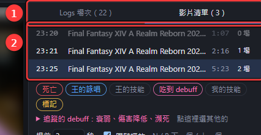

1. **分頁**：「Logs 場次」是這份 Logs 的每一場；「影片清單」是開啟的所有影片。還沒載入 Logs 時會直接顯示影片清單。
2. **影片清單**：依錄影時間排序，每個影片顯示開始時間、檔名、長度、裡面有幾場。正在看的那個會反白；**灰色**的是這份 Logs 裡沒有它的戰鬥。點一下就切換。

- 「Logs 場次」裡，在別的影片裡的場次後面有 **↪**；**灰色**的是哪個影片都沒有錄到的場次。
- 載入 Logs 後，會自動選第一場有錄到的 pull。
- 每個影片的時間對齊各自記住。

### 死因與 debuff

1. **死因**：每次死亡都會顯示是被哪一招打死的，例如「玩家G 死亡 ← 衝擊波」。點開後可以看到：
   - **死前 10 秒受到的傷害**：哪一招、誰打的、打了多少。
   - **死亡時身上有哪些 debuff**。
2. **誰吃了什麼 debuff**：例如「玩家D：傷害降低 ← 懲戒波」，表示玩家D 是被「懲戒波」這招上了傷害降低。很容易看出是誰站錯位置、誰踩了不該踩的。

### 統計

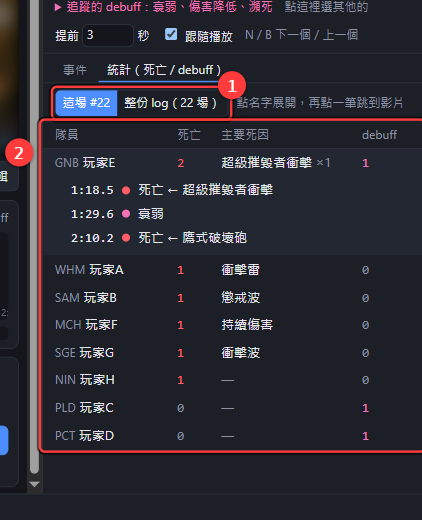

1. **這場 / 整份 log**：只看這一場，或統計整份 log 的全部 pull。
2. **每個隊員**：
   - 死了幾次、最常死在哪一招、吃了幾次 debuff。
   - 點名字可以展開明細，再點一筆就跳到影片裡那一刻。

### 用 FFLogs 復盤

沒有 ACT log 也可以用 FFLogs：在上方貼上 FFLogs 報告網址，按「載入」就好。

- 第一次使用要先到右上角 ☰ →「FFLogs API 金鑰」填自己的金鑰（免費，約 2 分鐘），見[☰ 選單](#-選單)。
- 載入後可以選「**我是誰**」，就能看到自己的技能。
- 招式名稱會顯示遊戲內的官方繁中，旁邊附上英文。

---

## 剪輯：片段、GIF、截圖、分段

在復盤頁的時間軸下面，一直展開。

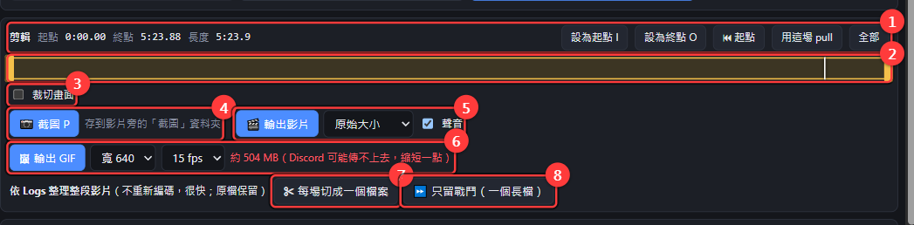

1. **起點 / 終點**：`I` / `O` 設定起點和終點，「用這場 pull」會直接選整場，「全部」選整支影片。
2. **範圍條**：拖兩端的黃色把手調整範圍。
3. **裁切畫面**：只輸出畫面的一部分，例如只要小地圖或隊伍列表。
4. **截圖**：按 `P` 把目前這一格存成圖片，存在影片旁邊的「截圖」資料夾。
5. **輸出影片**：把選取的範圍存成新的影片，可以選解析度、要不要聲音。
6. **輸出 GIF**：做成 GIF，可以選寬度和 fps。右邊會先估算檔案大小，太大傳不上 Discord 時會提醒你。
7. **每場切成一個檔案**：把整支長影片，依 log 裡的每次 pull 切成一場一個檔案，放在影片旁的「分段」資料夾。不小心串成一個長檔的影片也可以用這個切回每場一個檔。
8. **只留戰鬥（一個長檔）**：還是一個檔案，但 pull 和 pull 之間沒在打的時間（重新整隊、休息）都剪掉，存成「原檔名_只留戰鬥.mp4」。已經串成長檔的影片不會出現這個按鈕。

每一段都從倒數開始前 5 秒切起（高難本沒有倒數紀錄時，當作有 16 秒倒數），王轉場不會被切開（見[怎麼算一場](#跟-act-同步錄影)）。7、8 都不重新編碼，很快，原檔會保留；做完按「**在復盤開啟**」就能直接看，會自動對齊 Logs。需要先載入 Logs 才會出現這兩個按鈕。

---

## 壓縮

錄影檔很大，看完確認沒問題後，可以一次壓縮一整批，大多能省下一半以上的空間。

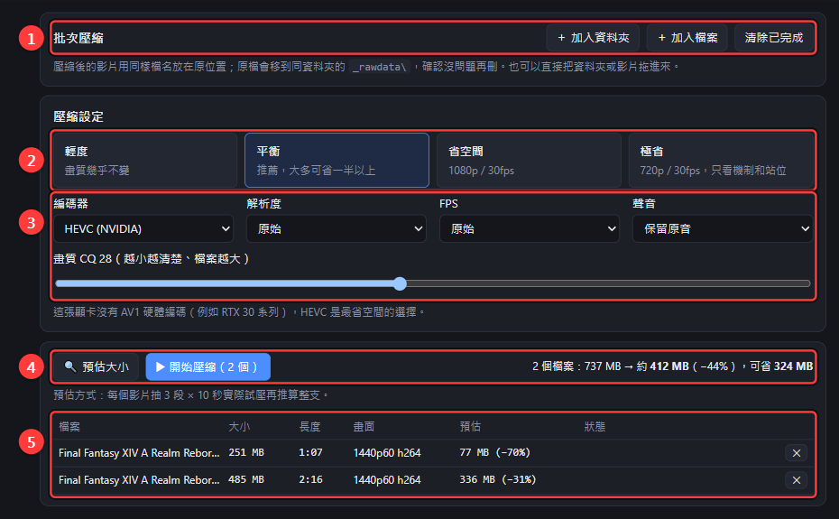

1. **加入影片**：「加入資料夾」或「加入檔案」，也可以直接把影片或資料夾拖進來。資料夾會連同裡面的子資料夾一起加入（例如每個遊戲的資料夾）。
2. **壓縮程度**：
   - **輕度**：畫質幾乎不變。
   - **平衡**（推薦）：大多可以省一半以上。
   - **省空間**：1080p / 30fps。
   - **極省**：720p / 30fps，只看機制和站位。
3. **進階設定**：編碼器、解析度、FPS、聲音品質、畫質，可以自己調。
4. **預估大小 / 開始壓縮**：
   - **預估大小**：每支影片實際試壓幾段，算出壓完大概多大、可以省多少（每支約 10 秒）。
   - **開始壓縮**：開始處理整批影片。
5. **檔案清單**：每支影片的大小、長度、畫面規格、預估大小和進度。

壓縮後的影片用同樣檔名放在原位置。原檔會移到同資料夾的 `_rawdata` 裡，確認沒問題再自己刪掉。

> **Windows 媒體播放器播舊影片沒有聲音？** Rewipe 1.2.2 以前錄的影片，聲音格式 Windows 內建播放器不支援（VLC、PotPlayer、Rewipe 都能播）。把它們用「壓縮」處理一次，聲音會自動轉成相容的格式。

---

## Rewink 拍照框

**Rewink**（Rewind 倒帶＋wink 眨眼）是遊戲裡的拍照框：在遊戲畫面上放一個透明的框，框住想拍的地方，按快門就拍下來，再加上相框、濾鏡、貼紙和文字，做成拍立得、雜誌封面、拍貼機……。FF14 以外的遊戲、桌面也能拍，錄影中也能拍。

> 遊戲要用「**無邊框視窗**」或「**視窗模式**」。遊戲用「獨佔全螢幕」時，拍照框疊不上去，也可能拍不到畫面（拍出來是黑的或是桌面）。FF14 在「系統設定 → 畫面設定」改。

### Rewink 分頁

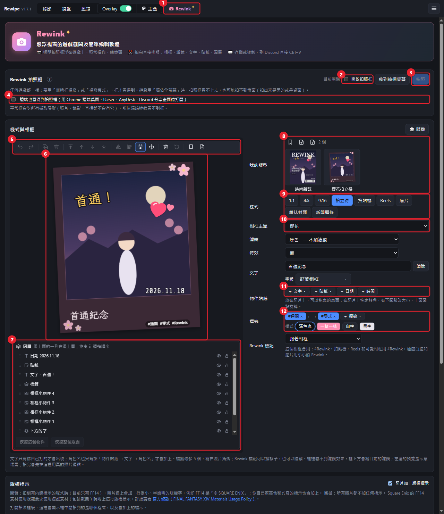

最上面是 Rewink 的簡介：**懸浮視窗的遊戲截圖及簡單編輯軟體**。

1. **Rewink 分頁**（有粉紅色相機和小星星的那個）。
2. **開啟拍照框**：框會出現在 Rewipe 視窗所在螢幕的正中間。框跑到別的螢幕、找不到時，按旁邊的「**移到這個螢幕**」。
3. **拍照**：跟按框旁邊的快門一樣（會倒數）。
4. **遠端也看得到拍照框**：平常框對所有擷取都是隱形的（照片、錄影、直播都不會有它），所以用 Chrome 遠端桌面、Parsec、Discord 分享畫面時看不到框。勾了就看得到；按快門的瞬間框會閃一下消失，照片裡一樣沒有框，但**錄影和直播會錄到框**，錄影時建議關掉。
5. **圖層工具列**：復原、重做、複製、刪除、上下層、翻轉、對齊、吸附、調整照片……，見[圖層編輯](#圖層編輯)。
6. **預覽**：還沒拍照時是示意場景，換樣式、相框、濾鏡會馬上看到效果；照片上的東西可以直接拖曳。拍完後換成真的照片（見[拍完編輯](#拍完編輯)）。
7. **圖層**：照片上所有東西的清單，最上面那一列在最上層。
8. **我的版型**：存起來的版面，點一下就套用，見[我的版型](#我的版型)。
9. **樣式**：1:1、4:5、9:16、拍立得、拍貼機（2～4 格）、Reels、底片、雜誌封面、新聞頭條。雜誌封面和新聞頭條有自己的「款式」（空白、時尚、旅遊、遊戲、偶像／空白、日報、號外、小報、英文報）。
10. **相框主題、濾鏡、特效、文字**：
    - **相框**：最上面是「**空白**」（只有照片，自己用文字和貼紙排），再來是只給照片用的相框（霓虹燈、掌上遊戲機、復古電腦螢幕、電影票、蜜桃泡泡……）和 Overlay 主題的相框。
    - **濾鏡** 22 種：暖色、冷調、黑白、柔光、日系、港風、底片、復古，還有水彩、油畫、素描、漫畫、像素這些藝術濾鏡。
    - **特效**：柔邊暗角、集中線、陽光斜灑、泡泡、櫻花、楓葉、下雪、下雨、窗上水珠、雲朵，可以調數量。
    - **文字**：每個樣式有自己寫字的地方（拍立得下方、雜誌的刊名和標題……），字型可以另外選（見[字型](#字型)）。
11. **物件貼紙**：文字、貼紙、日期、時間，放在照片上可以拖曳。貼紙裡的「**我的**」是自己上傳的圖片（見[我的貼紙](#我的貼紙)）。
12. **標籤**：寫在照片角落的 #標籤，可以選樣子。下面的「**Rewink 標記**」可以換樣子或隱藏。

右上的「**🎲 隨機**」會隨機換一組濾鏡、相框和貼紙，不會動到你打的文字和標籤。

### 拍照框

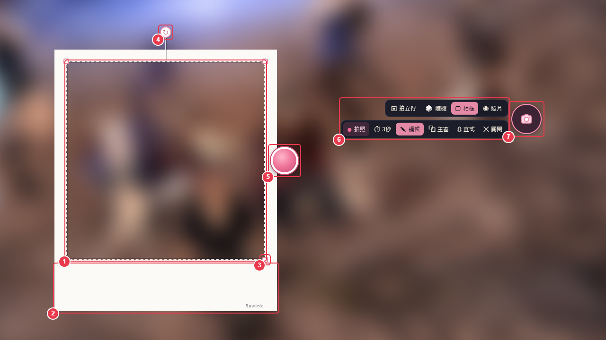

1. **拍到的範圍**：虛線框裡面就是照片。中間點得穿，照常操作遊戲、轉鏡頭。拖邊框移動。
2. **相框預覽**：在框旁邊直接看到選的相框（攝影機列的「相框」可以關掉），拖這裡也能移動。濾鏡和特效在框上看不到，在 Rewink 分頁的預覽看。
3. **四個角**：拉角調整大小，比例跟著樣式。
4. **↻ 旋轉**：拖著轉。畫面是斜的時候很好用：照片拍出來是正的，畫面跟著轉正。雙擊轉回 0°。
5. **快門**：按下會倒數再拍（秒數在 Rewink 分頁設定）。也可以按快捷鍵，預設 `Ctrl+F10`。
6. **攝影機列**：樣式、🎲 隨機、相框（框旁的相框預覽）、照片／動圖／來回；拍照、倒數秒數、編輯（拍完先編輯）、主窗（回到 Rewipe）、橫式／直式（列的方向）、關閉。
7. **小相機**：點一下把拍照框收起來／展開；拖曳移動整組。收起來時按快捷鍵只會展開，再按一次才拍。

- 框、倒數和 Overlay 都**不會**出現在照片裡。
- **拍貼機**：預設「一張一張按」，每按一次快門拍一格，中間可以換姿勢、移動框；拍滿才進編輯。也可以選「自動連拍」。
- **動圖／來回**：倒數完出現「**動！**」，錄 1～4 秒做成 GIF（來回 = 播完再倒著播回來）。

### 拍完編輯

「拍完先編輯」開著時（預設），拍好的照片不會馬上存：Rewipe 會跳到前面、在 Rewink 分頁打開，拍照框收成小相機在旁邊等。

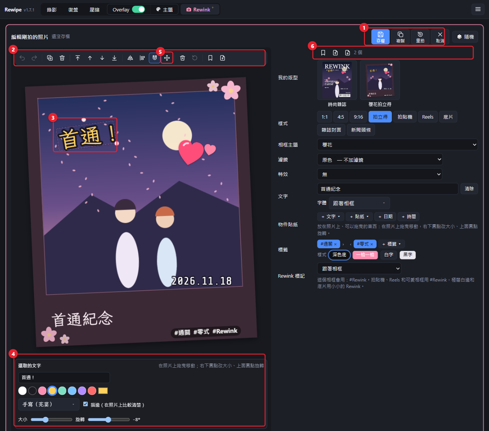

1. **存檔**（存到相簿資料夾，也會複製到剪貼簿）、**複製**（只複製，不存檔）、**重拍**（回到拍照框）、**取消**。
2. **圖層工具列**（見[圖層編輯](#圖層編輯)）。
3. **選取的東西**：用真的照片編輯。點一下照片上的東西就選到它，拖曳移動、拉右下圓點改大小、拉上面圓點旋轉。動圖會在這裡播放。
4. **選取的東西的設定**：文字內容、顏色、字型、描邊、大小、角度。選到版型元素（例如雜誌的刊名）時是大小、角度和字型。
5. **調整照片**：在照片格裡移動、放大照片（換一個裁切範圍）。
6. **我的版型**：另存成我的版型、匯出版型檔、匯入版型檔。

- 到 Discord 直接 `Ctrl+V` 就能貼上。GIF 是用檔案複製的，貼上後會動。
- 「物件貼紙 → 文字」可以插入**角色名**、**副本名**（ACT 讀到的；只有拍 FF14 時才有這兩個按鈕）。角色名只有按了才會加，不會自己出現。
- 換樣式時，照片會從中間裁成新的比例。

### 圖層編輯

照片上看得到的東西**全部都能調整**：自己加的文字和貼紙，還有版型本身的元素：雜誌的刊名、期數、條碼，報紙的報名、頭條、內文，相框主題的小物件，拍立得下方的字，Reels 的介面，底片的日期戳記，標籤，Rewink 標記和版權標示。

- **選取**：在預覽上點一下（重疊時選到最上面那一個；鎖定的點不到），或在「**圖層**」清單點那一列。
- **移動、大小、旋轉**：拖曳移動；拉右下圓點改大小；拉上面圓點旋轉（靠近 15° 會對齊）。方向鍵微調位置（按住 Shift 移動多一點）。
- **吸附**：拖曳時靠近頁面中線、邊界或其他東西的邊緣會自動對齊，並出現一條粉紅色的線。按住 `Alt` 暫時不吸附；工具列的磁鐵可以關掉。
- **圖層清單**：最上面的一列在最上層。拖曳左邊的 ⋮⋮ 調整順序；👁 顯示／隱藏；🔒 鎖定（在照片上點不到、拖不動）。滑鼠移到自己加的東西那一列，會出現複製和刪除。最下面固定是**照片**和**相框**（相框只能隱藏）。
- **工具列**（滑鼠停在按鈕上會顯示說明和快捷鍵）：

  | 按鈕 | 功能 | 快捷鍵 |
  |---|---|---|
  | 復原／重做 | 最多 60 步；一次拖曳、連續打字都算一步 | `Ctrl+Z`／`Ctrl+Y` |
  | 複製 | 複製選取的文字或貼紙 | `Ctrl+D` |
  | 刪除 | 刪除自己加的東西；版型元素則是隱藏 | `Delete` |
  | 移到最上層／上移／下移／移到最下層 | 調整上下順序 | `Ctrl+Shift+]`／`Ctrl+]`／`Ctrl+[`／`Ctrl+Shift+[` |
  | 左右翻轉、對齊頁面 | 對齊：靠左、置中、靠右、靠上、垂直置中、靠下 | |
  | 吸附 | 開／關 | 按住 `Alt` 暫時不吸附 |
  | 調整照片 | 在照片格裡拖曳移動照片、滾輪放大縮小（不會露出空白） | |
  | 清除全部物件、恢復整個版面 | 都會先問一次，也可以用復原救回來 | |

- 調整是**每個版型分開記**的：時尚雜誌排好的版面不會影響旅遊款，櫻花相框的小物件位置不會影響其他相框。圖層清單下面的「**恢復這個物件**」「**恢復整個版面**」只清掉目前這個版型的調整。
- **版權標示**可以移動和縮放，但不能隱藏或縮到看不見；要拿掉請在[版權標示](#版權標示和其他設定)依程式關掉。
- **空白**：相框、雜誌款式、報紙款式（和 Reels 的「介面」）最前面的「**空白**」只留下照片（拍貼機一樣有 2～4 格），沒有刊名、條碼、小物件這些，自己從零開始排。

### 字型

文字（自己加的文字、樣式本身的字）可以用 Rewink 內建的字型，也可以用**你電腦裡裝的字型**。

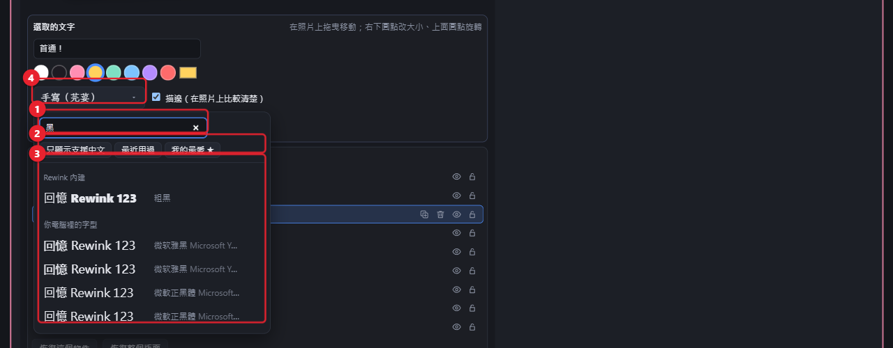

1. **搜尋**：打字就會篩選。不分大小寫、不管空格，也比對名稱中間的字，**中文名稱也找得到**（打「黑」會找到微軟正黑體；第一次打開時會花一點時間讀字型的中文名稱）。
2. **篩選**：只顯示支援中文、最近用過、我的最愛 ★（滑鼠移到字型那一列，右邊的 ★ 加到我的最愛）。
3. **清單**：Rewink 內建 → 最近用過 → 你電腦裡的字型，每一列都用那個字型顯示。用 ↑ ↓ 移動時，照片上的字會**直接換成那個字型**讓你看；按 `Enter` 套用，按 `Esc` 或點旁邊就恢復原本的字型。
4. **目前的字型**：點一下打開清單。

- 只會記住字型的**名稱**，不會複製字型檔。字型被刪掉、或版型是別人電腦做的時，按鈕會顯示「⚠ 這台電腦找不到這個字型」，照片改用預設字型。

### 我的貼紙

在「物件貼紙 → ＋ 貼紙 → **我的**」按「**上傳**」，選一張 PNG、JPG 或 WebP 圖片，就變成自己的貼紙，之後每張照片都能用。

- 建議用已經**去背（透明背景）的 PNG**。圖片沒有透明的地方時會提醒「這張圖沒有透明背景，貼上去會是一個方塊」：背景是一整片單色的話，按「**去背…**」點選要去掉的顏色、調容許度；也可以「**直接用**」。
- 圖片會自動縮小到最長 1024 px，最多 60 張。滑鼠移到貼紙上按 × 可以刪掉（照片上用到它的地方也會不見）。

### 我的版型

把排好的版面存起來重複用，也可以存成檔案分享給朋友。

- **另存成我的版型**：工具列或「我的版型」那一列的 🔖。會存下目前的樣式和款式（或相框）、圖層的調整、自己加的文字和貼紙、字型；可以選要不要連濾鏡一起存。
- **我的版型**：點縮圖就套用（可以復原）；滑鼠移過去有匯出、重新命名、刪除。
- **匯出版型**：存成一個 `.rewink-template` 檔，傳給朋友就好。檔案裡**只有版面**：沒有你的照片、角色名、用過的文字、存檔資料夾和版權標示的設定；字型只有名稱；自己上傳的貼紙圖片會一起放進去。
- **匯入版型**：把 `.rewink-template` 檔**拖進 Rewipe 視窗**，或按「我的版型」那一列的匯入。會先顯示預覽、名稱、作者和樣式；你的電腦沒有它用的字型或相框主題時會提醒（字型用預設、相框改用「空白」）。按「**加入並套用**」或「**加入我的版型**」才會加入，不會蓋掉現有的版型，名稱重複會自動加上（2）。

### 版權標示和其他設定

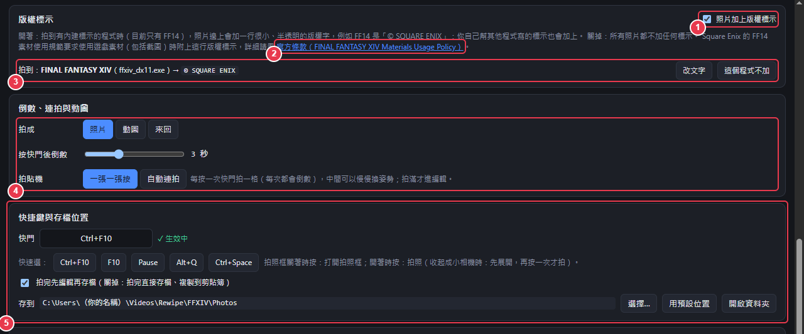

1. **照片加上版權標示**（預設開）：拍到有內建標示的程式時（目前只有 FF14），照片邊上會加一行很小、半透明的版權字，FF14 是「**© SQUARE ENIX**」。關掉的話，所有照片都不加。
2. Square Enix 的 FF14 素材使用規範要求使用遊戲素材（包括截圖）時附上這行標示，詳細請看[官方條款](https://support.na.square-enix.com/rule.php?id=5382&tag=authc)。
3. **拍到**：拍照框中間是哪個程式，以及會加上的標示。可以「**改文字**」、「**這個程式不加**」，改過的可以「**恢復內建**」。沒有內建標示的程式（例如桌面、其他遊戲）可以自己寫一行，例如「桌布 by 作者名」，下次拍同一個程式會自動帶入。
4. **倒數、連拍與動圖**：拍成照片／動圖／來回、按快門後倒數幾秒、拍貼機一張一張按或自動連拍。
5. **快捷鍵與存檔位置**：快門快捷鍵（預設 `Ctrl+F10`，下面有幾個一鍵選，旁邊會顯示有沒有生效；跟錄影快捷鍵相同或打字時會誤觸的組合會提醒）、拍完先編輯、存到哪裡（預設是錄影資料夾裡的 `Photos`）。

### 相簿、拼貼和通關提示

- **相簿**：Rewink 分頁最下面，列出存檔資料夾裡的照片和 GIF，可以複製、在資料夾中顯示、刪除（丟到資源回收筒）。
- **拼貼**：相簿的「**拼貼…**」，選 2～4 張照片，在編輯畫面拼成一條拍貼機，可以再換相框和文字。
- **通關提示**：FF14 打完副本（ACT 偵測到通關）時，Windows 會跳出「**要用 Rewink 拍紀念照嗎？**」，點一下就打開拍照框。不想看到的話，在 Rewink 分頁的「**FF14 小技巧**」關掉。

---

## ☰ 選單

右上角的 **☰**（三條線）。點選單外面或按 `Esc` 會關掉。

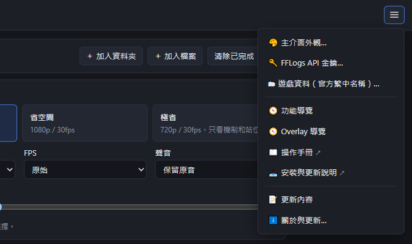

- **🎨 主介面外觀…**：主介面的主題、文字大小、字體，見[主介面外觀](#主介面外觀)。
- **🔑 FFLogs API 金鑰…**：

  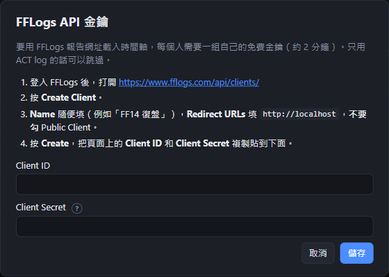

  - 照畫面上的 4 個步驟，到 FFLogs 網站申請自己的 Client ID 和 Client Secret 貼上。建立時**不要勾 Public Client**，不然不會有 Client Secret。
  - 金鑰只存在你自己的電腦上，並用 Windows 加密保存。
  - 只用 ACT log 的話可以跳過。
- **🗂 遊戲資料（官方繁中名稱）…**：直接從你電腦裡的 FF14 讀取招式和副本的**官方繁中名稱**，遊戲更新後也會自動重新讀取。
- **🧭 功能導覽**：重看第一次開啟時的導覽。
- **🧭 Overlay 導覽**：重看 Overlay 分頁的導覽。
- **📖 操作手冊 ↗**：開啟這份手冊（會開符合你目前版本的那一份）。
- **📥 安裝與更新說明 ↗**：下載、安裝、更新、防毒例外、解除安裝。
- **📝 更新內容**：每一版改了什麼。
- **ℹ️ 關於與更新…**：
  - 查看版本和作者。目前的版本號也會顯示在視窗標題和左上角的「Rewipe」旁邊。
  - 「檢查更新」可以手動檢查；開啟時也會自動檢查（可以關掉）。
  - 有新版時按「立即更新」就好（只有安裝版可以一鍵更新）。

---

## 常用快捷鍵

| 按鍵 | 功能 |
|---|---|
| `Ctrl+Alt+F9` | 開始 / 停止錄影（遊戲中也可以，可以自己改） |
| `Ctrl+F10` | Rewink 拍照：拍照框沒開時打開，開著時倒數拍照（可以自己改） |
| `空白鍵` | 播放 / 暫停 |
| `←` `→` | 往回 / 往前 5 秒（加 `Shift` 是 1 秒） |
| `,` `.` | 上一格 / 下一格 |
| `[` `]` | 調慢 / 調快播放速度 |
| `N` `B` | 下一個 / 上一個事件 |
| `I` `O` | 剪輯的起點 / 終點 |
| `P` | 截圖 |

---

**舊版的手冊**：從 1.2.4 起，每一版發布時的手冊都會保留，網址是 `https://github.com/LaneBlossom/rewipe/blob/v版本號/MANUAL.md`（例如 `v1.2.4`）。
