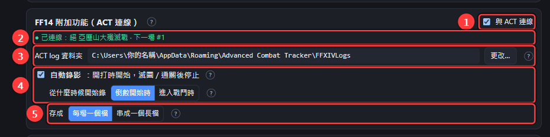
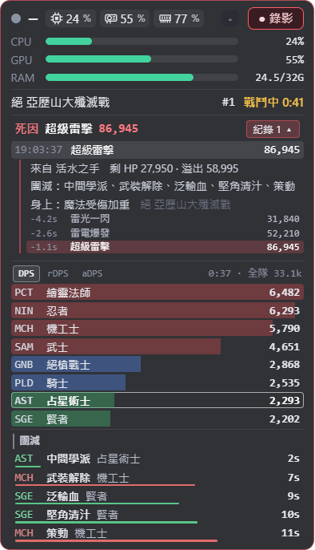
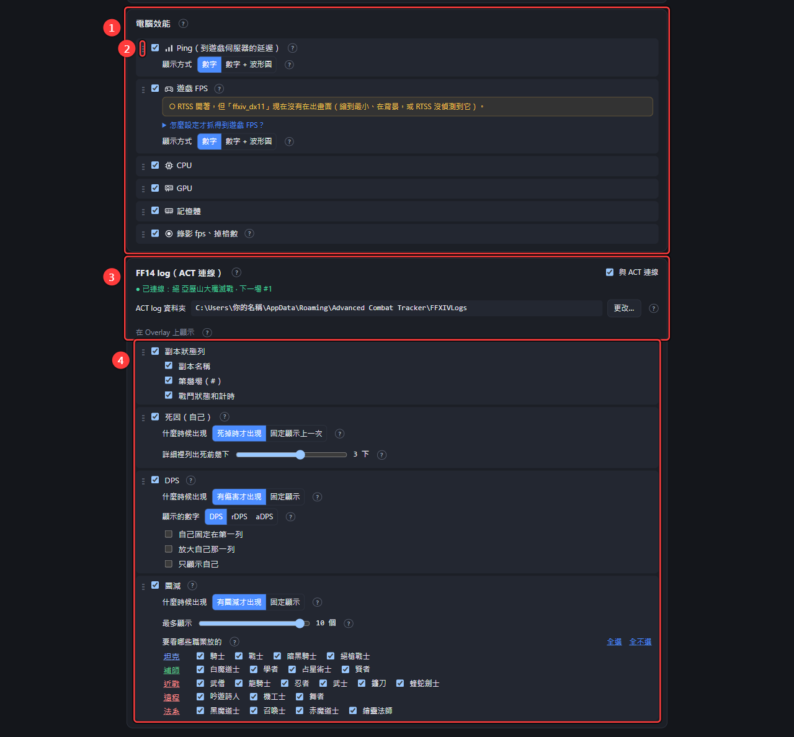
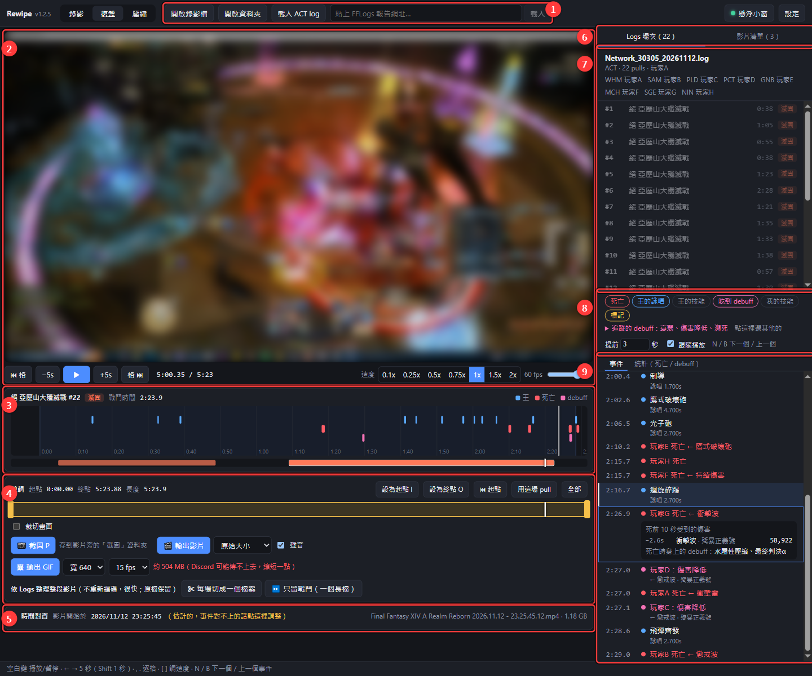
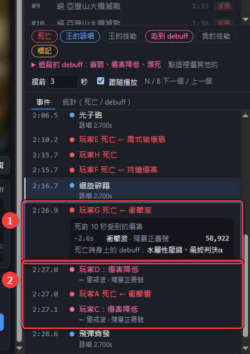

# FF14 擴充 操作手冊

> **適用版本：FF14 擴充 1.0.0（裝在 ReFlo 1.9 以上）**
>
> Rewipe 之後分成兩個部分：通用的錄影、播放、拍照程式 **ReFlo**，和裝在它裡面的 **FF14 擴充**。這份手冊只寫 **FF14 擴充加上的功能**：ACT 同步錄影、Overlay 的 FF14 欄位、ACT log／FFLogs 復盤、依 Logs 分段、Rewink 的 FF14 小功能。
>
> 錄影、播放與擷取片段、壓縮、Overlay、主題、Rewink 拍照框這些通用功能 → 看 📖 [ReFlo 操作手冊](https://github.com/LaneBlossom/reflo/blob/main/MANUAL.md)。

FF14 擴充是 FF14 高難副本的**錄影＋復盤**工具：錄下遊戲畫面，再對照 ACT 或 FFLogs 的紀錄，一眼看出每次 pull 誰在哪個機制倒下、吃了什麼 debuff，點一下就跳到影片裡那一刻。

> 截圖是 Rewipe 時代拍的，左上角寫著 Rewipe；裝了 FF14 擴充的 ReFlo 畫面一樣。截圖中的玩家名稱已換成「玩家A～H」，遊戲畫面也做了模糊處理。畫面上的「**?**」：滑鼠指過去會顯示那一項的說明。

**目錄**

- [安裝 FF14 擴充](#安裝-ff14-擴充)
- [快速開始](#快速開始)
- [跟 ACT 同步錄影](#跟-act-同步錄影)
- [Overlay 的 FF14 欄位](#overlay-的-ff14-欄位)
- [復盤：ACT log 和 FFLogs](#復盤act-log-和-fflogs)
  - [畫面總覽](#畫面總覽)
  - [很多個影片對同一份 Logs](#很多個影片對同一份-logs)
  - [死因與 debuff](#死因與-debuff)
  - [統計](#統計)
  - [用 FFLogs 復盤](#用-fflogs-復盤)
- [依 Logs 分段](#依-logs-分段)
- [Rewink 的 FF14 小功能](#rewink-的-ff14-小功能)
- [☰ 選單：FFLogs 金鑰和遊戲資料](#-選單fflogs-金鑰和遊戲資料)
- [舊版 Rewipe 的手冊](#舊版-rewipe-的手冊)

---

## 安裝 FF14 擴充

**已經在用 Rewipe**：打開 Rewipe（會自動更新到 1.9.0），上方出現「Rewipe 之後改成 ReFlo＋FF14 擴充」時按「**一鍵搬家**」：

1. 自動下載 FF14 擴充和 ReFlo 安裝程式（都會先驗證）。
2. 按「關掉 Rewipe 並安裝 ReFlo」，照安裝程式的步驟裝好。
3. ReFlo 第一次開啟時會問「要匯入 Rewipe 的設定嗎？」，按「**匯入**」。

設定、FFLogs 金鑰、ACT 資料夾、Overlay 主題、Rewink 的貼紙和版型都會帶過去，錄影照樣存到原本的資料夾。Rewipe 本身不會被改動，確認 ReFlo 沒問題後可以自己解除安裝（不一定要）。

**新安裝，或沒看到搬家提示**：

1. 到 [ReFlo 的下載頁](https://github.com/LaneBlossom/reflo/releases/latest) 安裝 ReFlo（電腦上有 Rewipe 的設定的話，第一次開啟時一樣會問要不要匯入）。
2. 到 [這裡的 Releases](https://github.com/LaneBlossom/rewipe/releases) 下載最新的 `ffxiv-x.x.x.reflo-ext`（標籤是 `ext-ffxiv-v…`）。
3. 打開 ReFlo，把 `.reflo-ext` 檔拖進視窗（或右上角 **☰ →「擴充功能」→「從檔案安裝…」**），確認後按「安裝」，再按「**立即重新開啟**」。

**更新、停用、移除**：都在 ReFlo 的 **☰ →「擴充功能」**。ReFlo 開啟時會自動檢查擴充的新版，有新版時 ☰ 上會有小圓點，按「更新」就好。ReFlo 只會安裝作者簽章過的擴充檔，檔案被改過就不會安裝或載入。

---

## 快速開始

1. 先開 **ACT**（要有 FFXIV 解析外掛，建議也裝 **OverlayPlugin**，才看得到倒數和戰鬥狀態）和 **FF14**，進到遊戲裡。
2. 錄影頁的「**FF14 附加功能（ACT 連線）**」顯示「**● 已連線**」。沒連上的話，見[跟 ACT 同步錄影](#跟-act-同步錄影)。
3. 勾「**自動錄影**」。之後每次倒數開打就自動開錄，滅團或通關自動停止。可以選每場存一個檔，或離開副本後把這次打的每一場串成一個長檔。
4. 錄完後按「**在復盤中開啟**」（或到「復盤」頁開啟錄影檔，每場一個檔的話可以一次全選，或直接開整個資料夾），再載入 ACT log 或貼上 FFLogs 網址，影片和戰鬥紀錄就會自動對齊。見[復盤](#復盤act-log-和-fflogs)。
5. 要用 FFLogs 復盤的話，到右上角 **☰ →「FFLogs API 金鑰」**填好。

---

## 跟 ACT 同步錄影

開著 ACT 的話，FF14 擴充會讀取 ACT 正在寫的 log，知道現在在哪個副本、第幾場、開打了沒有、是滅團還是通關。

1. **與 ACT 連線**：FF14 附加功能的總開關（跟 Overlay 分頁的同一個開關）。關掉的話就不讀 ACT，只當作一般錄影軟體使用，Overlay 上也不會有 FF14 的欄位。錄其他遊戲時會自動關閉。這只影響錄影和 Overlay；復盤頁不管這裡有沒有開，都可以載入 ACT log 和 FFLogs。
2. **ACT 連線狀態**：ACT 開著、進遊戲後 ACT 開始寫 log，這裡就會變成「● 已連線：副本名稱 · 下一場 #N」。
   - 下面一行是 ACT 的 **FFXIV 解析外掛版本**，以及有沒有 **OverlayPlugin**（從 ACT 正在寫的 log 開頭讀出來的）。
   - 「進入 / 離開戰鬥」和「倒數」的紀錄是 **OverlayPlugin** 寫的，自動錄影靠它判斷開打。顯示「OverlayPlugin 沒有」或「版本太舊」時，請在 ACT 的 **Plugins → Get Plugins…** 安裝或更新 OverlayPlugin。
   - 沒有 OverlayPlugin 時，會改用「有人開始打怪」判斷開打、15 秒沒人在打（或滅團 / 通關）就算打完，自動錄影照樣能用；但看不到倒數，「倒數開始時」不會觸發，請改成「進入戰鬥時」。
3. **ACT log 資料夾**：
   - 預設是 `%APPDATA%\Advanced Combat Tracker\FFXIVLogs`，下面會顯示找到的最新 log。
   - 顯示「找不到這個資料夾」的話，到 ACT 的 **Plugins → FFXIV Settings** 看 log 存在哪裡，再按「**更改…**」選那個資料夾。
4. **自動錄影**：開打時自動開始錄，滅團或通關後自動停止，沒在打的時間不錄，最省硬碟。「從什麼時候開始錄」有兩個選擇：
   - **倒數開始時**（高難本推薦）：含倒數；倒數取消或沒開打，檔案會自動刪掉。
   - **進入戰鬥時**：沒有倒數也會錄，但打野外的怪也會觸發。
5. **存成**：
   - **每場一個檔**：每次 pull 一個檔案。復盤時可以一次開很多個（見[很多個影片對同一份 Logs](#很多個影片對同一份-logs)）。
   - **串成一個長檔**：每場還是照常錄，**離開副本**（或休息超過 20 分鐘）後，把這次打的每一場接成一個檔案，例如 `FF14_…_絕伊甸_共12場.mp4`，每場的小檔會刪掉。不會重新編碼，很快。中途關掉 ReFlo 也沒關係，下次開啟時會接著合併（改回「每場一個檔」的話就不合併，小檔原封不動）。不小心串成長檔，也可以用[依 Logs 分段](#依-logs-分段)切回每場一個檔。

自動錄的檔案，檔名會帶副本名稱、第幾場、通關或滅團。之後在復盤頁打開時，會自動對齊 ACT 的紀錄；串成長檔的影片，時間軸上會標出每一場接起來的地方。

**開打了卻沒有自動錄影？** ReFlo 會跳出 Windows 通知（遊戲裡也看得到）並在錄影頁說明原因：

- 「自動錄影」沒有勾。
- 設定是「倒數開始時」，但這場開打前沒有倒數（例如副本小怪、野外）。
- ACT 沒有 OverlayPlugin，log 裡沒有戰鬥、倒數紀錄（見上面第 2 點）。

**怎麼算「一場」**（自動錄影、場次編號、即時 DPS、復盤、長影片分段都用同一套）：

- **在副本裡**（四人本、討伐、團本、高難本）：只有**滅團、通關、有人按新的倒數、離開副本**才算一場結束。王轉場、過場動畫時遊戲有時會暫時變成「非戰鬥中」，這不算結束，再久都是同一場、同一個檔案；四人本小怪一路打到王、中間沒滅團，就是一整個檔。滅團 / 通關的紀錄是 ACT 本身寫的，有沒有 OverlayPlugin 都準。
  - 保險：脫離戰鬥超過 **5 分鐘**還沒任何結束訊號（例如 ACT 中途重開漏了紀錄），會當成結束，存檔時把多等的那段剪掉。
- **野外、打木樁**：不會有滅團 / 通關 / 離開副本的訊號，所以**脫戰 60 秒**就算結束，存檔時自動把多等的那段剪掉，影片停在打完後 6 秒。60 秒內再開打還是同一場。
- 怎麼知道在副本裡：副本會在 ACT 的 log 寫副本事件的紀錄，野外不會；名稱是高難本的也直接算副本。
- **開打前**：有倒數就從倒數開始都算這一場（倒數時唱的起手、開怪前的增益都看得到）；沒有倒數只算開打前 5 秒。高難本（名稱開頭是「絕」「極」「滅」，或有「零式」）如果 log 裡沒有倒數紀錄，會當作有 16 秒倒數。

---

## Overlay 的 FF14 欄位

Overlay 本身（最上面那一列、電腦效能、外觀、主題）見 [ReFlo 操作手冊](https://github.com/LaneBlossom/reflo/blob/main/MANUAL.md)。FF14 擴充會在 Overlay 上加這幾個欄位（ACT 連線時才會出現；錄其他遊戲時不會出現）：

- **副本狀態列**：副本名稱、第幾場、倒數 / 戰鬥中和計時 / 滅團 / 通關，三項可以分開勾選。
- **死因**：自己倒下後大約 1 秒，用**一行**顯示打死你的招式和傷害，被復活後消失。
- **DPS / HPS**：這一場每個人的數字和全隊總和，坦克藍色、補師綠色、DPS 紅色，你自己那一行有外框。標題列可以直接切換 **DPS / rDPS / aDPS / HPS / rHPS**（出現哪幾個在 Overlay 分頁勾選）：
  - **DPS**：自己打出的傷害（包含隊友團輔加成的部分）。
  - **rDPS**：扣掉隊友團輔帶來的傷害，再加上自己的團輔幫隊友多打的傷害。
  - **aDPS**：扣掉隊友團輔帶來的傷害，只看自己的實力。
  - **HPS**：有效治療量，不算溢補（補到滿血以外的部分）。**rHPS**：原始治療量，溢補也算進去。溢補用補血那一刻目標的血量估算；盾不算治療。
  - 跟 FFLogs 同概念；爆擊、直擊類團輔是估計值，數字會跟 FFLogs 略有差距。召喚獸的傷害算給主人。戰鬥結束後保留上一場的數字，下一場開打時重新計算。
- **團減**：隊伍現在生效的團減和團盾：誰放的、什麼技能、還剩幾秒，底下的細線是剩下的時間。快結束的排上面。技能名稱直接用遊戲裡的名稱。騎士的武裝戍衛只算實際生效的時間（騎士停止後再 5 秒）。

**死亡紀錄**：死因那一行右邊的「**紀錄**」按鈕（沒在顯示死因時，副本狀態列上的「**死亡 N**」）會打開死亡紀錄：這次開 ReFlo 以來每次死亡的時間和死因。點其中一筆看詳細：

- 來自哪個敵人、被打之前**剩多少 HP**、**溢出**多少（被一下打死還是被補不起來）。
- 當時有哪些**團減**（沒有的話顯示紅色「沒有」），身上有什麼 **debuff**（例如易傷）。
- **死前幾下**的傷害和時間，打死你的那一下標紅。看得出是被連段打死、DoT 死，還是一下秒殺。
- 只看得到隊伍的團減，看不到個人減傷（例如鐵壁）。log 裡找不到確定打死你的那一下時，只顯示最後一下，不顯示 HP 和溢出。

**Overlay 分頁裡的 FF14 設定**：

1. **電腦效能**：ReFlo 本身的設定。
2. **`⋮⋮`**：按住拖動，調整在 Overlay 上的順序（FF14 的項目也一樣）。
3. **FF14 log（ACT 連線）**：跟錄影頁的「FF14 附加功能」是同一組設定：與 ACT 連線的開關、連線狀態、ACT log 資料夾（見[跟 ACT 同步錄影](#跟-act-同步錄影)）。
4. **在 Overlay 上顯示**：
   - **副本狀態列**：副本名稱、第幾場、戰鬥狀態可以分開勾選。
   - **死因**：「死掉時才出現」或「固定顯示上一次」（一直留著這個副本上一次的死因，復活後變淡）；「詳細裡列出死前幾下」0～5 下。
   - **DPS / HPS**：可以切換的數字（DPS、rDPS、aDPS、HPS、rHPS 勾選要哪幾種，只勾一個就固定顯示那一個）、自己固定在第一列、放大自己那一列、只顯示自己。
   - **團減**：最多顯示幾個（1～10）、要看哪些職業放的（例如只看坦克和補師）。
   - **什麼時候出現**：DPS、團減都可以選「有才出現」或「**固定顯示**」。固定顯示會一直空出固定的位置（DPS 是隊伍人數那麼多列：8 人副本 8 列、4 人副本 4 列、單人 1 列；團減是「最多顯示」那麼多列），欄位不會上下伸縮，眼睛每次看同一個地方就找得到。

---

## 復盤：ACT log 和 FFLogs

### 畫面總覽

在復盤頁打開錄影檔，再載入 ACT log 或 FFLogs 報告，影片和戰鬥紀錄就會自動對齊。

1. **載入**：
   - **開啟錄影檔**、**開啟資料夾**：選要看的影片，可以一次選很多個，也可以直接把影片拖進視窗。
   - **載入 ACT log**：選 ACT 的 `Network_xxxxx.log`。也可以直接拖進來。
   - **FFLogs 網址**：貼上 FFLogs 報告網址後按「載入」，需要先到右上角 ☰ →「FFLogs API 金鑰」填好。
   - 右邊整欄的左邊界可以**左右拖動**調整寬度，pull 清單下面的線可以**上下拖動**調整高度，點兩下恢復預設。
   - 不管錄影頁現在設定成錄哪個遊戲、有沒有開 FF14 附加功能，復盤頁都可以載入 ACT log 和 FFLogs。
2. **影片播放器**：逐格、±5 秒、0.1x～2x 慢動作，看清楚每一個機制。
3. **這場 pull 的時間軸**：上排是王的技能和詠唱，下面依序是死亡、debuff、我的技能。點時間軸任何位置就跳到那個時間；滑鼠指到事件點會顯示它的時間和名稱。**滑鼠滾輪**可以放大縮小（以滑鼠位置為中心），放大後按住拖曳或 `Shift` + 滾輪左右移動，右上角「還原」回到整場。下方長條是整支影片，標出每場 pull 在影片裡的位置（串成長檔的影片，虛線是接起來的地方）。
4. **擷取片段**：選一段輸出成影片、GIF 或截圖（見 ReFlo 手冊）；載入 Logs 後，「用這場 pull」可以直接選整場，還多了[依 Logs 分段](#依-logs-分段)。
5. **時間對齊**：平常收起來，標題列會顯示影片從幾點開始。黃字「估計的」表示是從檔名或檔案時間推算的，事件對不上時點一下展開調整。
   - ReFlo（和 Rewipe）錄的影片會精確對齊，不用動。
   - 如果差了一點：在右邊點一個明顯的事件（例如某人死亡），用逐格找到畫面上它真正發生的那一格，再按藍色按鈕，就會對準。
   - 也可以用 ±1 秒 / ±0.1 秒微調。
6. **分頁**：一次開了很多個影片時，這裡有「**Logs 場次**」和「**影片清單**」兩個分頁，見下面。只開一個影片時不會出現。
7. **pull 清單**：這份 log 裡的每一場，包含副本、第幾場、打了多久、通關或滅團。最上面是檔名、錄製者和 pull 數；隊員名單平常收起來，點「▸ 這場的隊員」展開，只列目前這場的隊員和職業。點一場就跳到那場；那場在別的影片裡時，會自動切過去。
8. **篩選**：
   - 要顯示哪些事件：死亡、王的詠唱、王的技能、debuff、我的技能、標記。
   - 要追蹤哪些 debuff：預設是衰弱、傷害降低、瀕死，可以自己加。
   - **提前 N 秒**：點事件時，從事件發生前幾秒開始播，看得到前因後果。
   - **跟隨播放**：播放時，事件清單自動捲到目前的位置。
9. **事件清單**：這場發生的所有事件，正在播放的那一行會以琥珀色標出。點一下就跳到影片裡那一刻。用鍵盤的 `N` / `B` 可以跳到下一個 / 上一個事件。
   - 開打前的事件（倒數、倒數時唱的起手、增益）時間是負的，例如「-3.1」。
   - 同一招範圍技打到好幾個人只算一筆；不同小怪各自用同一招會分開列。

### 很多個影片對同一份 Logs

自動錄影每場一個檔、或資料夾裡有很多段錄影時，不用一個一個開：

1. 「**開啟錄影檔**」一次選很多個，或「**開啟資料夾**」，或把一堆影片 / 整個資料夾拖進視窗。
2. 再載入一次 ACT log（或 FFLogs）。
3. 右邊「**Logs 場次**」分頁裡點哪一場，就會自動切到有那場的影片，並跳到那場開頭。點統計裡的事件也一樣。

1. **分頁**：「Logs 場次」是這份 Logs 的每一場；「影片清單」是開啟的所有影片。還沒載入 Logs 時會直接顯示影片清單。
2. **影片清單**：依錄影時間排序，每個影片顯示開始時間、檔名、長度、裡面有幾場。正在看的那個會反白；**灰色**的是這份 Logs 裡沒有它的戰鬥。點一下就切換。

- 「Logs 場次」裡，在別的影片裡的場次後面有 **↪**；**灰色**的是哪個影片都沒有錄到的場次。
- 載入 Logs 後，會自動選第一場有錄到的 pull。
- 每個影片的時間對齊各自記住。

### 死因與 debuff

1. **死因**：每次死亡都會顯示是被哪一招打死的，例如「玩家G 死亡 ← 衝擊波」。點開後可以看到：
   - **死前 10 秒受到的傷害**：哪一招、誰打的、打了多少。
   - **死亡時身上有哪些 debuff**。
2. **誰吃了什麼 debuff**：例如「玩家D：傷害降低 ← 懲戒波」，表示玩家D 是被「懲戒波」這招上了傷害降低。很容易看出是誰站錯位置、誰踩了不該踩的。

### 統計

1. **這場 / 整份 log**：只看這一場，或統計整份 log 的全部 pull。
2. **每個隊員**：
   - 死了幾次、最常死在哪一招、吃了幾次 debuff。
   - 點名字可以展開明細，再點一筆就跳到影片裡那一刻。

### 用 FFLogs 復盤

沒有 ACT log 也可以用 FFLogs：在上方貼上 FFLogs 報告網址，按「載入」就好。

- 第一次使用要先到右上角 ☰ →「FFLogs API 金鑰」填自己的金鑰（免費，約 2 分鐘），見[☰ 選單](#-選單fflogs-金鑰和遊戲資料)。
- 載入後可以選「**我是誰**」，就能看到自己的技能。
- 招式名稱會顯示遊戲內的官方繁中，旁邊附上英文。

---

## 依 Logs 分段

載入影片和 Logs 後，復盤頁「擷取片段」區會多出這兩個按鈕：

- **每場切成一個檔案**：把整支長影片，依 log 裡的每次 pull 切成一場一個檔案，放在影片旁的「分段」資料夾。不小心串成一個長檔的影片也可以用這個切回每場一個檔。
- **只留戰鬥（一個長檔）**：還是一個檔案，但 pull 和 pull 之間沒在打的時間（重新整隊、休息）都剪掉，存成「原檔名_只留戰鬥.mp4」。已經串成長檔的影片不會出現這個按鈕。

每一段都從倒數開始前 5 秒切起（高難本沒有倒數紀錄時，當作有 16 秒倒數），王轉場不會被切開（見[怎麼算一場](#跟-act-同步錄影)）。兩個都不重新編碼，很快，原檔會保留；做完按「**在復盤開啟**」就能直接看，會自動對齊 Logs。

---

## Rewink 的 FF14 小功能

Rewink 拍照框本身見 [ReFlo 操作手冊](https://github.com/LaneBlossom/reflo/blob/main/MANUAL.md)。裝了 FF14 擴充、拍 FF14 時多了：

- **角色名、副本名**：「物件貼紙 → 文字」可以插入**角色名**、**副本名**（ACT 讀到的；只有拍 FF14 時才有這兩個按鈕，只有按了才會加上）。
- **通關提示**：打完副本（ACT 偵測到通關）時，Windows 會跳出「**要用 Rewink 拍紀念照嗎？**」，點一下就打開拍照框。不想看到的話，在 Rewink 分頁的「**FF14 小技巧**」關掉。
- **版權標示**：拍 FF14 的照片，邊上會加一行很小、半透明的「**© SQUARE ENIX**」（Rewink 分頁的「照片加上版權標示」，預設開）。Square Enix 的 FF14 素材使用規範要求使用遊戲素材（包括截圖）時附上這行標示，詳細請看[官方條款](https://support.na.square-enix.com/rule.php?id=5382&tag=authc)。

---

## ☰ 選單：FFLogs 金鑰和遊戲資料

FF14 擴充會在右上角的 **☰** 加兩個項目：

- **🔑 FFLogs API 金鑰…**：

  

  - 照畫面上的 4 個步驟，到 FFLogs 網站申請自己的 Client ID 和 Client Secret 貼上。建立時**不要勾 Public Client**，不然不會有 Client Secret。
  - 金鑰只存在你自己的電腦上，並用 Windows 加密保存。
  - 只用 ACT log 的話可以跳過。
- **🗂 遊戲資料（官方繁中名稱）…**：直接從你電腦裡的 FF14 讀取招式和副本的**官方繁中名稱**，遊戲更新後也會自動重新讀取。

---

## 舊版 Rewipe 的手冊

Rewipe（1.9.0 是最後一版）的完整手冊都保留著，網址是 `https://github.com/LaneBlossom/rewipe/blob/v版本號/MANUAL.md`，例如 [v1.8.0](https://github.com/LaneBlossom/rewipe/blob/v1.8.0/MANUAL.md)。
