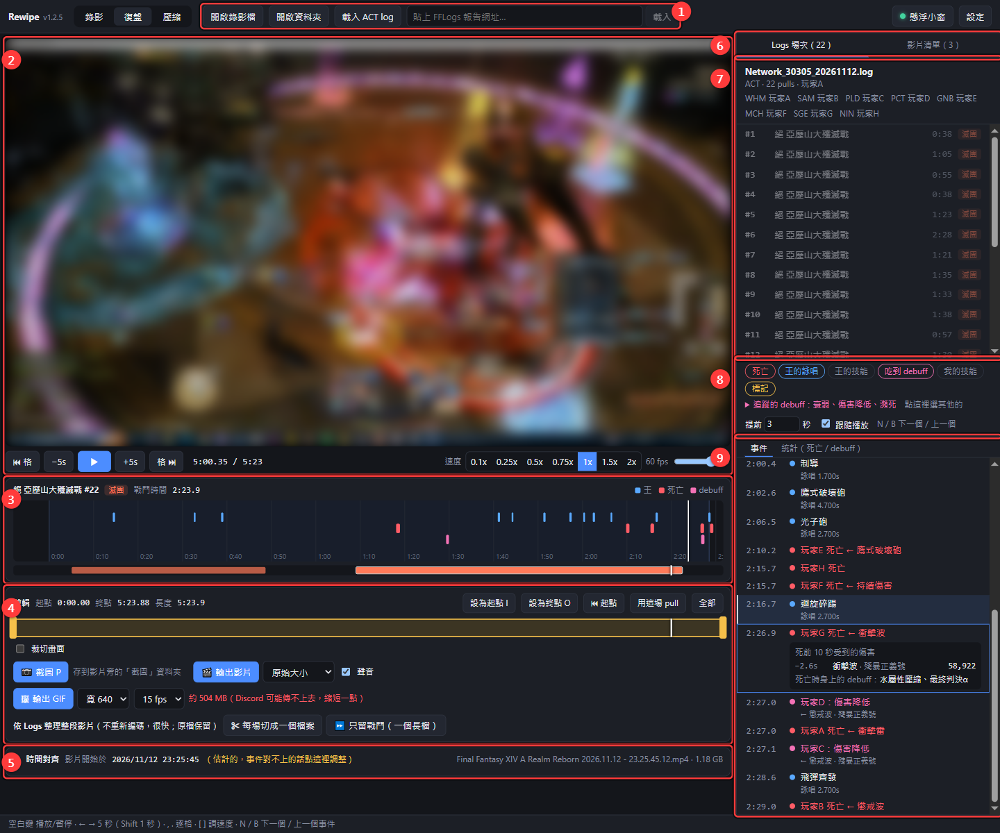

# Rewipe

FF14 高難副本的**錄影、剪輯與復盤**工具（其他遊戲也能錄），還有遊戲拍照框 **Rewink**。作者：LaneBlossom

> **Rewipe** = **Rewind**（倒帶）＋ **wipe**（滅團）——滅團了，就倒帶回去看看哪裡出錯。

- **錄影**：顯卡硬體編碼、只錄遊戲視窗；配合 ACT 開打自動錄、滅團自動停，每場一個檔或串成一個長檔
- **復盤**：載入 ACT log 或 FFLogs 網址，時間軸和影片自動對齊，點事件就跳到那一刻；可以一次開很多個影片（播放清單）
- **死因與 debuff**：每次死亡顯示死於哪一招、死前受到的傷害；誰在哪個機制吃了什麼 debuff
- **Overlay**：浮在遊戲上直接錄影 / 停止；顯示 Ping、遊戲 FPS、電腦效能，FF14 還有即時 DPS / rDPS / aDPS、團減和死因；不錄影也能當監控儀表板，不會被錄進影片
- **剪輯**：裁切畫面、輸出片段、GIF、截圖；長影片依 Logs 每場切開，或只留戰鬥
- **壓縮**：一次壓縮整批錄影檔，大多能省一半以上空間
- **主題**：15 個 Overlay 主題（招牌「夜櫻」），也能用主題編輯器做自己的主題、上傳圖片、分享給朋友；部分主題連主視窗也一起換
- **Rewink 拍照框**：在遊戲畫面上放一個透明的拍照框，拖曳、縮放、轉角度，按快門倒數拍照（框和 Overlay 不會入鏡）；拍立得、拍貼機、雜誌封面、新聞頭條等 9 種樣式，相框、濾鏡、特效、貼紙和文字，也能拍動圖；存檔同時複製，Discord 直接貼上。拍 FF14 時自動加上小小的 © SQUARE ENIX 版權標示
- 招式與副本名稱使用遊戲內官方繁中

## 📥 [安裝說明](INSTALL.md)　　📖 [操作手冊](MANUAL.md)

- **[安裝說明](INSTALL.md)**：下載、安裝、Windows 警告、防毒例外、更新、解除安裝
- **[操作手冊](MANUAL.md)**：快速開始，以及每個頁面、每個功能怎麼用（附圖解）

## 下載

👉 **[到 Releases 下載最新版](../../releases/latest)**

| 檔案 | 說明 |
|---|---|
| `Rewipe-Setup-x.x.x.exe` | **安裝版（推薦）**，之後在軟體裡按一下就能更新 |
| `Rewipe-Portable-x.x.x.exe` | 免安裝版，點兩下就能用，但不能自動更新 |

第一次開啟時 Windows 可能顯示「Windows 已保護您的電腦」：按 **其他資訊 → 仍要執行**。詳細步驟見[安裝說明](INSTALL.md)。

## 需求

- Windows 10 / 11（64 位元）
- 建議有 NVIDIA / AMD / Intel 顯卡（沒有也能錄，但會吃 CPU）
- 使用 ACT 功能需要 ACT（FFXIV_ACT_Plugin，建議加裝 OverlayPlugin 才看得到倒數和戰鬥狀態）；使用 FFLogs 需要自己的免費 API 金鑰（軟體內有教學）

## 授權與著作權

© 2026 [LaneBlossom](https://github.com/LaneBlossom)，保留所有權利。

Rewipe 可以免費下載、個人使用，也歡迎分享下載頁面的連結。但**未經作者同意，請勿反編譯或解開程式（例如解開 app.asar）、交給 AI 或其他工具分析改寫、修改、重新散布或以它為基礎製作類似的軟體**。完整條款見 [LICENSE](LICENSE)。

內附的 FFmpeg、Electron 等第三方元件依各自的授權條款提供。

## 非官方工具聲明

Rewipe 是玩家自製的**非官方工具**，與 SQUARE ENIX CO., LTD. 及 FINAL FANTASY XIV 各地區的營運商無關，未獲其授權、贊助或認可。FINAL FANTASY、FINAL FANTASY XIV、FFXIV 是 Square Enix 集團的商標或註冊商標。

- Rewipe 不包含、也不散布遊戲的資料檔；招式與副本名稱是在你自己的電腦上，從你安裝的遊戲、你自己的戰鬥紀錄或 FFLogs 讀取。
- Rewipe 不修改遊戲程式或檔案，不讀寫遊戲的記憶體，也不攔截遊戲的網路封包。
- ACT、FFXIV_ACT_Plugin、OverlayPlugin、RTSS、FFLogs 是各自作者的軟體與服務，Rewipe 沒有內附它們，也與它們無關。
- 使用第三方工具可能違反遊戲的使用條款，風險由使用者自行承擔。完整條款見 [LICENSE](LICENSE)。
